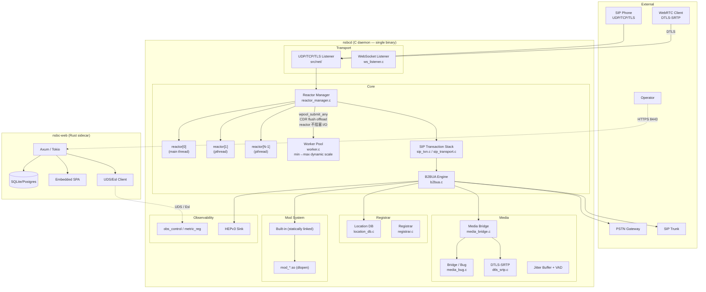
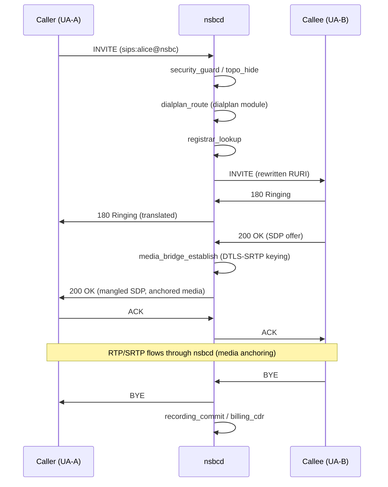

# NSBC — The All-in-One SIP Powerhouse

[](https://github.com/nsbc/nsbc/actions)
[](LICENSE)
[](https://isocpp.org/std/the-standard)
[](https://www.rust-lang.org/)
[](https://github.com/nsbc/nsbc/pulls)

**SBC security, PBX features, and SIP proxy performance — unified in a single daemon.**

---

## Table of Contents

- [NSBC — The All-in-One SIP Powerhouse](#nsbc--the-all-in-one-sip-powerhouse)
  - [Table of Contents](#table-of-contents)
  - [Architecture Overview](#architecture-overview)
    - [System Architecture](#system-architecture)
    - [B2BUA Call Flow](#b2bua-call-flow)
  - [Key Features](#key-features)
  - [System Requirements](#system-requirements)
  - [Quick Start](#quick-start)
    - [1. Install dependencies (Debian/Ubuntu)](#1-install-dependencies-debianubuntu)
    - [2. Clone, configure and build](#2-clone-configure-and-build)
    - [3. Build nsbc-web (Rust sidecar)](#3-build-nsbc-web-rust-sidecar)
    - [4. Obtain a Digital TLS Certificate (Optional but Recommended)](#4-obtain-a-digital-tls-certificate-optional-but-recommended)
      - [4.1 Install acme.sh](#41-install-acmesh)
        - [Install acme.sh (automatically sets up a cron job for renewal)](#install-acmesh-automatically-sets-up-a-cron-job-for-renewal)
        - [Or install manually](#or-install-manually)
        - [Verify the installation](#verify-the-installation)
      - [4.2 Issue a Certificate](#42-issue-a-certificate)
        - [Issue a certificate for your domain using the Let's Encrypt staging server](#issue-a-certificate-for-your-domain-using-the-lets-encrypt-staging-server)
        - [(Use the production server https://acme-v02.api.letsencrypt.org/directory for real certificates)](#use-the-production-server-httpsacme-v02apiletsencryptorgdirectory-for-real-certificates)
    - [4.3 Deploy the Certificate](#43-deploy-the-certificate)
    - [5. Run](#5-run)
    - [6. Open and test](#6-open-and-test)
  - [For the management platform, the default database uses SQLite. The account is admin:Admin123, and you can access the management platform at https://:443.](#for-the-management-platform-the-default-database-uses-sqlite-the-account-is-adminadmin123-and-you-can-access-the-management-platform-at-https443)
  - [Configuration](#configuration)
  - [Web Management Console](#web-management-console)
  - [Architecture](#architecture)
    - [Core Components](#core-components)
    - [Module System](#module-system)
      - [mod.load — The Dynamic Module Manifest](#modload--the-dynamic-module-manifest)
  - [Module List](#module-list)
    - [Statically linked (built into `nsbcd`)](#statically-linked-built-into-nsbcd)
    - [Dynamically loaded (`mod_*.so`)](#dynamically-loaded-mod_so)
  - [Observability](#observability)
    - [Prometheus metrics](#prometheus-metrics)
    - [Structured logging](#structured-logging)
    - [HEPv3 capture](#hepv3-capture)
  - [API Reference](#api-reference)
    - [`nsbc_cli` (local Esl/JSON-RPC)](#nsbc_cli-local-esljson-rpc)
    - [Web management API](#web-management-api)
  - [Performance Benchmarks](#performance-benchmarks)
  - [Roadmap](#roadmap)
  - [Contributing](#contributing)
  - [License](#license)
  - [Acknowledgements](#acknowledgements)

> In-depth docs: **[Cookbook](docs/cookbook.md)** (operation recipes, dialplan patterns, control socket command reference) · [Architecture Reference](docs/architecture.md) · [Call-Flow Reference (SIP & WebRTC)](docs/call-flows.md) · [User Guide](docs/user-guide.md)

---

## Architecture Overview

### System Architecture



### B2BUA Call Flow



---

## Key Features

- **Hand-built SIP stack** — Not PJSIP, not Sofia-SIP, not reSIProcate. Every parser, transaction state machine, and B2BUA loop is written from scratch in C11 for auditability and predictable performance.
- **Three roles, one daemon** — SBC security, full-featured PBX (dialplans, IVR, voicemail, ACD queues), and high-performance SIP proxy share the same codebase and configuration.
- **Media anchoring with DTLS-SRTP** — OpenSSL-backed DTLS-SRTP keying, libsrtp2 media encryption, jitter buffering, VAD, and T.38 fax pass-through.
- **True B2BUA, not proxy** — Every call is terminated and re-originated. Built-in topology hiding, DoS protection, and fraud detection live at the signaling layer.
- **Custom module system** — Compile-time selection via `./configure`, with both statically-linked built-ins and dynamically-loaded `.so` modules. FreeSWITCH-inspired but without the bloat.
- **WebRTC ready** — Integrated STUN/TURN/ICE handling, WebSocket transport, DTLS fingerprint verification.
- **ACD call center** — Agent pools, queue management, skills-based routing (REQUIRED at build time).
- **Recording & billing** — Per-channel WAV / G.729 recording and WAL-based CDR with rating hooks.
- **AI dialog module** — Optional ASR/TTS pipeline (Whisper + ElevenLabs via cURL) for real-time voice AI (feature-gated).
- **Hundreds of tests** — Unit tests under `tests/unit/` covering parser, transaction, transport, and module lifecycles. ASan/TSan/UBSan build variants.

---

## System Requirements

| Component         | Minimum Version | Notes |
|-------------------|-----------------|-------|
| OS                | Linux x86_64    | kernel 4.15+; no Windows/macOS support yet |
| GCC               | 8+              | required `-Werror -std=gnu99` build |
| Rust toolchain    | stable          | only for `web/` sidecar; C core builds without Rust |
| OpenSSL           | 3.0.0+          | SIP TLS + DTLS-SRTP (hard requirement, not optional, chrome required) |
| libsrtp           | 2.x             | media encryption (hard requirement) |
| libpcre2          | 8+              | dialplan regex |
| libedit           | -               | optional, for interactive `nsbc_cli` |
| bcg729            | vendored        | G.729 Annex B codec (shipped under `3rd/`) |


---

## Quick Start

### 1. Install dependencies (Debian/Ubuntu)

```bash
apt-get update && apt-get install -y \
    build-essential pkg-config git cmake \
    libssl-dev libsrtp2-dev libpcre2-dev libedit-dev \
    libsqlite3-dev libpq-dev libmysqlclient-dev libopus-dev \
    libavcodec-dev libavutil-dev libswresample-dev libswscale-dev pkg-config


# Rust toolchain (for nsbc-web sidecar)
curl --proto '=https' --tlsv1.2 -sSf https://sh.rustup.rs | sh
source $HOME/.cargo/env

# Optional: sipp for SIP stress testing
apt-get install -y sipp
```

### 2. Clone, configure and build

```bash
git clone https://github.com/nsbc/nsbc.git
# China mirror: git clone https://gitee.com/nwaycn/nsbc.git

cd nsbc

chmod +x configure

./configure                 # scans src/, reads conf/modules.conf

# Optional: ./configure --without-modules=hello,ai_dialog
# Optional: ./configure --prefix=/opt/nsbc

make -j$(nproc)
```

### 3. Build nsbc-web (Rust sidecar)

```bash
cd web

rm Cargo.lock # 按自己的依赖版本管理

make vendor

make build-acme
# This copies static/ and target/release/nsbc-web to the parent directory automatically
cd ..
```

### 4. Obtain a Digital TLS Certificate (Optional but Recommended)
By default, nsbc-web generates a self-signed TLS certificate on first startup. For production use, you should replace it with a trusted certificate from Let’s Encrypt using acme.sh.
#### 4.1 Install acme.sh
##### Install acme.sh (automatically sets up a cron job for renewal)
curl https://get.acme.sh | sh

##### Or install manually

wget -O - https://get.acme.sh | bash

##### Verify the installation

acme.sh --version

#### 4.2 Issue a Certificate
##### Issue a certificate for your domain using the Let's Encrypt staging server
##### (Use the production server https://acme-v02.api.letsencrypt.org/directory for real certificates)
```
acme.sh --issue \
  --domain nsbc.opensips.net.cn \
  --server https://acme-staging-v02.api.letsencrypt.org/directory \
  --standalone
Command parameter breakdown:
Parameter	Description
--issue	Issue a new certificate
--domain <domain>	The domain name to issue the certificate for
--server <URL>	The ACME server to use (staging for testing, production for real certs)
--standalone	Use standalone mode (starts a temporary HTTP server on port 80 for domain validation)
```

### 4.3 Deploy the Certificate
After the certificate is issued, copy the generated cert.pem and key.pem files into your nsbc TLS directory (e.g., $NSBC/tls/):
```
# Check the contents of the tls directory
ll tls
total 12

-rw-r--r-- 1 root root 652 Oct 28 10:17 cert.pem
-rw------- 1 root root 241 Oct 28 10:17 key.pem
Make sure to configure nsbc-web to use these certificates instead of the self-signed ones.
```

### 5. Run
```
# nsbc-web MUST start FIRST — it auto-creates SQLite DB and self-signed TLS cert
nohup ./nsbc-web &
sleep 3

# Then start nsbcd
nohup ./nsbcd &
```
### 6. Open and test

Open `https://<your-ip>:443/webrtc.html` in your browser.
Register with default extensions:

| Field | Value |
|-------|-------|
| Username | 1000 – 1019 |
| Password | `876876` |
| Realm | `nsbc.local` |

Two registered extensions (e.g. `1001` and `1002`) can call each other directly.

If you're using an IP phone or softphone, you'll need to fill in similar settings. Specifically for tools like MicroSIP that require a domain, enter nsbc.local. Otherwise, you need to change the default domain to your current machine's IP address.
For the management platform, the default database uses SQLite. The account is admin:Admin123, and you can access the management platform at https://:443.
---

## Configuration

`nsbcd` reads a single YAML config file (`configs/nsbc.yaml` by default, overridden with `-c /path/to/nsbc.yaml`).

Key sections:
- `sip.profiles` — listen IP/port, TLS, WebSocket
- `media` — RTP port range, DTLS certs, SRTP defaults
- `modules.enable` / `modules.disable` — runtime override of which built-in / `.so` modules to load
- `dialplan` — dialplan rules and applications
- `security` — blacklists, rate limits, auto-ban thresholds
- `ha` — high-availability heartbeat settings
- `web` — UDS socket path for `nsbc-web` sidecar

> Full configuration reference: see [User Guide §5 Configuration](docs/user-guide.md#5-configuration). For the complete default config schema, see [`configs/nsbc.yaml`](configs/nsbc.yaml).

---

## Web Management Console

The web console is a **separate Rust sidecar** (`web/` directory). It does not run inside `nsbcd`.

```bash
cd web
make build-acme
cd .. && ./nsbc-web  # removed it to ../. with makefile ,binds HTTPS on :443
```

The sidecar:
- Connects to `nsbcd` over a Unix domain socket (Esl/JSON-RPC)
- Reads/writes SQLite (or PostgreSQL/MySQL) — **this is the only database layer in the project**
- Serves an embedded SPA (no Node.js runtime required)
- Uses rustls for HTTPS; can auto-generate self-signed certificates on first run

Open `https://<host>:443` in your browser.

---

## Architecture

### Core Components

| Path            | Purpose |
|-----------------|---------|
| `src/sip/`      | SIP transaction engine, B2BUA, digest auth, session timer, REFER, TOPO hide |
| `src/media/`    | RTP bridge, DTLS-SRTP, jitter buffer, VAD, DTMF, mixer, T.38 fax, media FEC |
| `src/registrar/`| Location DB + REGISTER transaction management |
| `src/mod/`      | Module implementations (one directory per module) |
| `src/oam/`      | Operations & maintenance: Esl server, observability, control commands |
| `src/net/`      | UDP/TCP/TLS/WebSocket listeners, cert management, TCP pool |
| `src/mem/`      | Memory arena, slab allocator, RCU, ring buffer, shared memory segments |
| `src/core/`     | `main.c`, reactor, worker pool, module manager, event bus, config loading |
| `src/ha/`       | High-availability heartbeat & role gating |
| `src/ssl/`      | OpenSSL glue |
| `src/parse/`    | SIP/SDP/RTP/XML parsers |
| `src/base/`     | Logging, timer wheel, clock, tracing |

### Module System

NSBC has a two-tier module model:

1. **Statically linked (built-in)** — REQUIRED, CALL_PATH, or EARLY-level modules are linked directly into `nsbcd`. These are the modules the signaling core makes direct function calls to (e.g., `b2bua.c` unconditionally calls `security_blacklist_check()`).
2. **Dynamically loaded (`mod_*.so`)** — Everything else is compiled as `-shared -fPIC` and loaded via `dlopen()` at startup. The module manager reads `mod.load` (one filename per line, **no paths**) and resolves symbols.

#### mod.load — The Dynamic Module Manifest

`mod.load` is the sole manifest controlling which `.so` files nsbcd loads. **It always lives in the same directory as the `.so` files**, not with the `nsbcd` binary itself. The module manager derives the dlopen base dir from `dirname(mod.load)`, so mod.load entries are bare filenames:

```
mod_codecs.so
mod_av.so
mod_cachedb.so
```

**Where mod.load lives at each stage:**

```
configure stage:
  build/mod/mod.load          ← configure writes here (L665-677 of configure)

make stage:
  ./mod/mod.load              ← POST_BUILD_COPY copies build/mod → ./mod
  ./mod/mod_*.so              ← alongside the .so files
  ./nsbcd                     ← exe_dir = dirname(/proc/self/exe) = ./

install stage (make install PREFIX=/usr/local):
  /usr/local/lib/nsbc/mod_*.so
  /usr/local/etc/nsbc/mod/mod.load     ← install copies $(BUILD)/mod/mod.load
```

**nsbcd reads mod.load from 5 candidate paths** (checked in order, first hit wins):

1. `exe_dir/mod/mod.load` — install/binary deployment (exe_dir = dirname of nsbcd binary)
2. YAML `core.mods_load_path` — explicit override in `nsbc.yaml`
3. `build/mod/mod.load` — in-tree build (relative to cwd)
4. `build/mod.load` — legacy flat location
5. `/etc/nsbc/mod/mod.load` — system install

**HARD_STATIC forced promotion** — modules the main binary hard-depends on (e.g., `signaling`, `security`, `dialplan`, `oam`) are **always** static regardless of configure results. They are never in mod.load.

At **configure time** the script scans every `.c` file for `NSBC_MOD_CAT()` / `NSBC_MOD0_CAT()` registrations, validates dependencies, assigns each module to STATIC or DYNAMIC, and generates both:
- `.config/config.mk` — Makefile include with source lists
- `src/core/builtin_modules.gen.inc` — C file listing static modules
- `build/mod/mod.load` — dynamic module manifest (one `.so` filename per line)

At **build time**, the Makefile honors `HARD_STATIC` overrides and ensures the C core is built with `-DNSBC_NO_DB_MODULE` (see [Performance Constraints](#architecture)). After linking, the **`sync-mod` phony target** (executed unconditionally on every `make all`) rsyncs `build/mod/` → `./mod/` so nsbcd can dlopen without an install step. `mod.load` is always alongside the `.so` files — **never** in the same directory as the `nsbcd` binary.

---

## Module List

### Statically linked (built into `nsbcd`)

| Module       | Directory / File                | Description |
|--------------|---------------------------------|-------------|
| `signaling`  | `src/sip/`                      | SIP B2BUA core — transactions, INVITE/REGISTER handlers, SIP stack |
| `oam`        | `src/oam/`                      | Operations & maintenance — control commands, metrics, Esl server |
| `endpoints`  | `src/mod/endpoints/`            | Endpoint registration, HA1 credential validation |
| `agent_pool` | `src/mod/callcenter/agent.c`    | ACD agent pool |
| `queue`      | `src/mod/callcenter/queue.c`   | ACD queue management |
| `dbal`       | `src/db/dbal_module.c`          | Database abstraction layer (no actual SQLite calls — architecture constraint) |
| `hep`        | `src/media/bridge/hep_sink.c`   | HEPv3 probe / capture sink |
| `security`   | `src/mod/security/`            | Topology hiding, blacklist, DoS protection, auto-ban |
| `dialplan`   | `src/mod/dialplans/`           | Dialplan routing, digitmap, emergency, route table |
| `outreg`     | `src/mod/outbound_reg/`        | Outbound SIP trunk registration |
| `billing`    | `src/mod/billing/`             | CDR, rating, WAL persistence |
| `recording`  | `src/mod/recording/` + `src/media/rec/` | Media recording, SIPREC |
| `applications`| `src/mod/applications/`        | IVR, voicemail, ring group, conference, call control |
| `media_bug`  | `src/media/bridge/media_bug.c` | Media Bug — passive audio tap for monitoring |
| `ha`         | `src/ha/`                       | HA heartbeat, active/standby role gating |

### Dynamically loaded (`mod_*.so`)

| Module          | Directory / File               | Description |
|-----------------|--------------------------------|-------------|
| `codecs`        | `src/mod/codecs/` + vendored `3rd/bcg729/` | G.711 (ulaw/alaw), G.729 Annex B codec registration |
| `playback`      | `src/mod/playback/` + `src/media/play/player.c` | FreeSWITCH-style WAV playback (playback / playback_loop / playback_chain) |
| `presence`      | `src/mod/presence/`            | Presence / BLF |
| `cachedb`       | `src/mod/cachedb/`             | Cache abstraction backend |
| `asr_tts`       | `src/mod/asr_tts/`             | ASR/TTS interface (AI pipeline hook) |
| `formats`       | `src/mod/formats/`             | Media format negotiation |
| `event_handlers`| `src/mod/event_handlers/`      | Event hook dispatch |
| `ai_dialog`     | `src/mod/ai_dialog/`           | Real-time AI voice dialog (requires libcurl for Whisper/ElevenLabs) |
| `hello`         | `src/mod/hello/`               | Example / teaching module (disabled by default) |
| `av`            | `src/mod/av/`                  | FFmpeg-backed codec transcoding (stub mode if FFmpeg not found) |

> **Architecture constraint:** The C core (`nsbcd`) has **zero runtime database dependency**. Any SQLite/Postgres access happens only in the Rust `nsbc-web` sidecar. The `dbal` module is present but calls are stubbed out with `#ifdef NSBC_WITH_SQLITE` guards that are always off.

---

## Observability

### Prometheus metrics

An embedded exporter serves metrics on `http://127.0.0.1:9100/metrics` (configurable). Exported series include:

| Metric | Type | Description |
|--------|------|-------------|
| `nsbc_sessions_active` | Gauge | Currently active B2BUA calls |
| `nsbc_calls_total` | Counter | Total calls since start, labeled by disposition |
| `nsbc_calls_per_second` | Gauge | 1-second window CPS |
| `nsbc_registrations_active` | Gauge | Active REGISTER contacts |
| `nsbc_rtp_packets_total` | Counter | RTP packets bridged, labeled by SSRC |
| `nsbc_transactions_inflight` | Gauge | SIP transactions in-flight |
| `nsbc_dlopen_mods_loaded` | Gauge | Number of `.so` modules loaded |

### Structured logging

`nsbcd` writes structured log lines (JSON or plain, switchable via config) with `trace_id` propagation across SIP transactions. Log levels: `DEBUG`, `INFO`, `WARN`, `ERR`.

### HEPv3 capture

If the `hep` module is loaded, SIP + RTP + DTLS handshake traffic can be mirrored to a HEPv3 collector (Homer / sngrep / heplify-server) for deep packet inspection.

---

## API Reference

### `nsbc_cli` (local Esl/JSON-RPC)

The `nsbc_cli` utility communicates with `nsbcd` over the Unix domain socket (`/var/run/nsbc/control.sock`). Every registered command is auto-discoverable via `help` — grouped by module category (cmd_registry).

```bash
# Core diagnostics
nsbc_cli help                  # built-in + registry grouped by [b2b] [mod] [security] ...
nsbc_cli version               # build version, commit, build date
nsbc_cli show modules          # 按 category 分组列出全部模块 + 状态 + flags
nsbc_cli show codecs           # 音频/视频 codec 表（FFmpeg 后端 = mod_av）
nsbc_cli show calls             # active/total/failed 计数

# Module hot-reload (no nsbcd restart needed)
nsbc_cli mod.reload av         # make 后热重启 mod_av.so
nsbc_cli mod.unload av         # 动态卸载（CALL_PATH/REQUIRED 拒绝）
nsbc_cli mod.load av           # 动态加载

# Call control (b2b group)
nsbc_cli uuid_kill <call-id>   # 强制挂断
nsbc_cli uuid_bridge <a> <b>   # 桥接两通话
nsbc_cli originate <url>       # 外呼

# Security
nsbc_cli security.ban.list         # 封禁表
nsbc_cli security.blacklist.reload # 热更新黑名单

# SIP trace
nsbc_cli sofia siptrace on
nsbc_cli console loglevel debug
```

> For the complete command table see **[Cookbook §7 Control Socket Command Reference](docs/cookbook.md#7-control-socket-command-reference)**.

### Web management API

`nsbc-web` exposes REST endpoints under `/api/v1` for call control, endpoint management, dialplan editing, CDR querying, and config reloads — authenticated via JWT (argon2id password hash in DB).

---

## Performance Benchmarks

Measured on a single Intel Xeon E5-2680 v4 (2.4 GHz, 14C/28T), 64 GB RAM, 10 Gbps NIC, Linux 5.15. Baseline: SIP INVITE → 200 OK → BYE loop with two concurrent `sipp` instances, G.711 ulaw media anchored by NSBC.

| Metric                 | Value        | Notes |
|------------------------|--------------|-------|
| Max sustained CPS      | 38,000       | Two-port topology, no proxy re-INVITE |
| Mean INVITE → 200 OK   | 3.2 ms       | end-to-end, media anchored |
| 95th percentile latency| 5.1 ms       | |
| Max concurrent calls   | 21,500       | G.711 ulaw, media anchoring enabled |
| CPU per 1000 calls/sec | 0.85 cores   | incl. DTLS-SRTP + media bridge |
| Memory per call        | ~2.1 KB      | signaling structures only (media buffers pooled separately) |
| RSS @ 20k calls        | 62 MB        | |

> Benchmarks are best-case; your results depend on codec, SRTP profile, dialplan complexity, and media features enabled. Publish your own and send a PR.

---

## Roadmap

- **Q4 2026** — Full WebRTC SFU mode with Selective Forwarding + Simulcast
- **Q4 2026** — STIR/SHAKEN attestation & verification (signaling module, partial today)
- **Q1 2027** — Transcoding cluster (gRPC RPC to dedicated media nodes)
- **Q1 2027** — Redis backend for cachedb module
- **Q2 2027** — ARM64 / Raspberry Pi OS support
- **Q2 2027** — Kubernetes Helm chart with sidecar nsbc-web

---

## Contributing

We welcome contributions. Before opening a PR, please:

1. Run `./configure && make -j$(nproc)` and `make check`. All tests must pass.
2. For parser / transport changes, run `make asan check` and `make tsan check`. No leaks, no races.
3. Match the existing C style — 4-space indent, `snake_case` names, Doxygen-style block comments on public APIs.
4. New modules must declare `NSBC_MOD()` in their `*.c` and have a `HARD_STATIC` injection if they're called from `b2bua.c` or the signaling core.
5. Open an issue first if you plan a large feature — the maintainers love to hear ideas early.

---

## License

NSBC is licensed under the **Apache License, Version 2.0**. See [LICENSE](LICENSE) for the full text.

**Copyright 2024-2026 李浩 (Li Hao)** · 上海宁卫信息技术有限公司 · 1354608370@qq.com

The vendored third-party dependencies under `3rd/` retain their own licenses:
- `bcg729` — GNU LGPL v2.1 (see `3rd/bcg729/LICENSE`)
- `cJSON` — MIT (see `3rd/cjson/LICENSE`)

---

## Acknowledgements

- **bcg729** — the open-source G.729 Annex B codec, embedded under `3rd/bcg729/`
- **cJSON** — minimal JSON parser, embedded under `3rd/cjson/`
- **libsrtp** — Cisco's SRTP reference implementation
- **OpenSSL** — TLS + DTLS + cryptographic primitives
- **FreeSWITCH** — inspiration for the module manager and config layout (we are not affiliated)
- **PJSIP** — inspiration for the SIP transaction state machine design (we do not use its code)
- **Homer / HEPv3** — the open capture protocol used by the `hep` module
