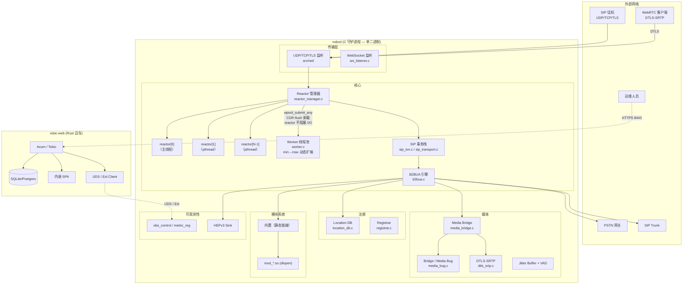
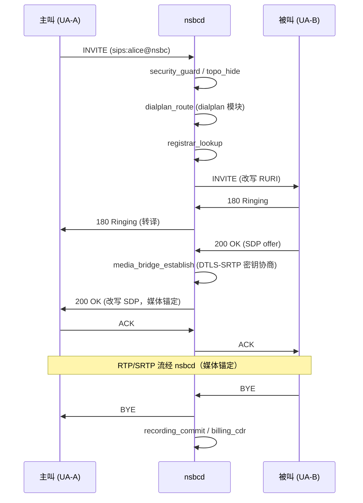

# NSBC — 一体化 SIP 全栈平台

[](https://github.com/nsbc/nsbc/actions)
[](LICENSE)
[](https://isocpp.org/std/the-standard)
[](https://www.rust-lang.org/)
[](https://github.com/nsbc/nsbc/pulls)

**SBC 安全、PBX 功能、SIP 代理性能 — 统一守护进程，单二进制部署。**

---

## 目录

- [NSBC — 一体化 SIP 全栈平台](#nsbc--一体化-sip-全栈平台)
  - [目录](#目录)
  - [架构总览](#架构总览)
    - [系统架构](#系统架构)
    - [B2BUA 呼叫流程](#b2bua-呼叫流程)
  - [核心特性](#核心特性)
  - [系统要求](#系统要求)
  - [快速上手](#快速上手)
    - [1. 安装依赖（Debian/Ubuntu）](#1-安装依赖debianubuntu)
    - [2. 克隆、配置与构建](#2-克隆配置与构建)
    - [3. 构建 nsbc-web（Rust 边车）](#3-构建-nsbc-webrust-边车)
    - [4. 运行](#4-运行)
    - [5. 打开并测试](#5-打开并测试)
  - [配置说明](#配置说明)
  - [Web 管理控制台](#web-管理控制台)
  - [内部架构](#内部架构)
    - [核心组件](#核心组件)
    - [模块系统](#模块系统)
  - [模块清单](#模块清单)
    - [静态链接（内置 nsbcd）](#静态链接内置-nsbcd)
    - [动态加载（`mod_*.so`）](#动态加载mod_so)
  - [可观测性](#可观测性)
    - [Prometheus 指标](#prometheus-指标)
    - [结构化日志](#结构化日志)
    - [HEPv3 抓包](#hepv3-抓包)
  - [API 参考](#api-参考)
    - [`nsbc_cli`（本地 Esl / JSON-RPC）](#nsbc_cli本地-esl--json-rpc)
    - [Web 管理 API](#web-管理-api)
  - [性能基准](#性能基准)
  - [路线图](#路线图)
  - [贡献指南](#贡献指南)
  - [许可证](#许可证)
  - [致谢](#致谢)

> 深入文档：[架构参考](docs/architecture.md) ·
> [调用链参考（SIP 与 WebRTC）](docs/call-flows_cn.md) ·
> [使用指南](docs/user-guide_cn.md)

---

## 架构总览

### 系统架构



### B2BUA 呼叫流程



---

## 核心特性

- **自研 SIP 协议栈** — 不基于 PJSIP、Sofia-SIP、reSIProcate。每个解析器、事务状态机、B2BUA 环路均用 C11 从零实现，可审计、可预测。
- **三合一守护进程** — SBC 安全防护、完整 PBX（拨号计划 / IVR / 语音信箱 / ACD 队列）、高性能 SIP 代理，共享一套代码和配置。
- **媒体锚定 + DTLS-SRTP** — OpenSSL 驱动的 DTLS-SRTP 密钥协商，libsrtp2 媒体加密，jitter buffer，VAD，T.38 Fax 透传。
- **真 B2BUA 而非代理** — 每通呼叫都被终止并重新发起，拓扑隐藏、DoS 防护、欺诈检测内置于信令层。
- **自定义模块系统** — `./configure` 编译期选择，同时支持静态链接的内置模块和动态加载的 `.so`。灵感源自 FreeSWITCH，但已去除冗余。
- **WebRTC 就绪** — 内置 STUN/TURN/ICE 处理、WebSocket 传输、DTLS 指纹校验。
- **ACD 呼叫中心** — 坐席池、技能队列（构建时 REQUIRED，不可禁用）。
- **录音与计费** — 每通道 WAV / G.729 录音 + WAL 式 CDR，可挂接计费 hooks。
- **AI 对话模块** — 可选 ASR/TTS 管线（Whisper + ElevenLabs，通过 libcurl），实时语音 AI（feature-gated）。
- **丰富的单元测试** — `tests/unit/` 覆盖解析器、事务、传输、模块生命周期。ASan/TSan/UBSan 构建变体可用。

---

## 系统要求

| 组件             | 最低版本       | 说明 |
|------------------|----------------|------|
| 操作系统         | Linux x86_64   | kernel 4.15+；暂不支持 Windows / macOS |
| GCC              | 8+             | 需 `-Werror -std=gnu99` |
| Rust 工具链      | stable         | 仅 `web/` 边车需要；C 核心可独立构建 |
| OpenSSL          | 1.1.1+         | SIP TLS + DTLS-SRTP（硬依赖，不可选） |
| libsrtp          | 2.x            | 媒体加密（硬依赖） |
| libpcre2         | 8+             | 拨号计划正则 |
| libedit          | —              | 可选，用于交互 `nsbc_cli` |
| bcg729           | 已打包 vendored| G.729 Annex B 编解码（位于 `3rd/`） |


---

## 快速上手

### 1. 安装依赖（Debian/Ubuntu）

```bash
apt-get update && apt-get install -y \
    build-essential pkg-config git cmake \
    libssl-dev libsrtp2-dev libpcre2-dev libedit-dev \
    libsqlite3-dev libpq-dev libmysqlclient-dev libopus-dev

# Rust 工具链（用于 nsbc-web 边车）
curl --proto '=https' --tlsv1.2 -sSf https://sh.rustup.rs | sh
source $HOME/.cargo/env

# 可选：sipp 用于 SIP 压测
apt-get install -y sipp
```

### 2. 克隆、配置与构建

```bash
git clone https://github.com/nsbc/nsbc.git
# 国内镜像：git clone https://gitee.com/nwaycn/nsbc.git

cd nsbc

chmod +x configure

./configure                 # 扫描 src/，读取 conf/modules.conf

# 可选：./configure --without-modules=hello,ai_dialog
# 可选：./configure --prefix=/opt/nsbc

make -j$(nproc)
```

### 3. 构建 nsbc-web（Rust 边车）

***中国大陆用户可能代理下更好,添加或更新~/.cargo/config.toml文件***
```bash
[source.crates-io]
replace-with = 'ustc'

[source.ustc]
registry = "sparse+https://mirrors.ustc.edu.cn/crates.io-index/"
```


```bash
cd web

rm Cargo.lock # 按自己的依赖版本管理

make vendor

make build-acme
# 会自动把 static/ 和 target/release/nsbc-web 复制到上级目录
cd ..
```

### 4. 运行

```bash
# 必须先启动 nsbc-web —— 它会自动创建 SQLite DB 和自签 TLS 证书
nohup ./nsbc-web &
sleep 3

# 再启动 nsbcd
nohup ./nsbcd &
```

### 5. 打开并测试

浏览器访问 `https://<your-ip>:443/webrtc.html`，注册默认分机：

| 项 | 值 |
|----|----|
| 用户名 | 1000 – 1019 |
| 密码 | `876876` |
| Realm | `nsbc.local` |

两个已注册的分机（例如 `1001` 和 `1002`）即可直接互拨。

---

## 配置说明

`nsbcd` 读取单个 YAML 配置文件（默认 `configs/nsbc.yaml`，可用 `-c /path/to/nsbc.yaml` 覆盖）。

主要配置段：
- `sip.profiles` — 监听 IP/端口、TLS、WebSocket
- `media` — RTP 端口范围、DTLS 证书、SRTP 默认参数
- `modules.enable` / `modules.disable` — 运行时动态覆盖内置 / `.so` 模块加载
- `dialplan` — 拨号计划规则与应用
- `security` — 黑名单、速率限制、auto-ban 阈值
- `ha` — 高可用心跳设置
- `web` — `nsbc-web` 边车连接用的 UDS socket 路径

> 完整配置手册：见 [用户指南 §5 配置](docs/user-guide_cn.md#5-配置)。默认配置所有键的完整说明：[`configs/nsbc.yaml`](configs/nsbc.yaml)。

---

## Web 管理控制台

Web 控制台是独立的 Rust 边车（`web/` 目录），**不运行在 nsbcd 内部**。

```bash
cd web
cargo build --release      # 或 cargo build --features acme 启用 Let's Encrypt
./target/release/nsbc-web  # HTTPS :8443
```

边车职责：
- 通过 Unix Domain Socket（Esl/JSON-RPC）连接 `nsbcd`
- 读写 SQLite（或 PostgreSQL/MySQL）—— **这是全项目唯一的数据库层**
- 内嵌 SPA，编译期 embed 前端，零 Node.js 运行时依赖
- 使用 rustls 提供 HTTPS，首次启动可自动生成自签证书

浏览器访问 `https://<host>:8443`。

---

## 内部架构

### 核心组件

| 路径             | 用途 |
|------------------|------|
| `src/sip/`       | SIP 事务引擎、B2BUA、Digest 认证、会话定时器、REFER、拓扑隐藏 |
| `src/media/`     | RTP bridge、DTLS-SRTP、Jitter Buffer、VAD、DTMF、Mixer、T.38 Fax、媒体 FEC |
| `src/registrar/` | Location DB + REGISTER 事务管理 |
| `src/mod/`       | 各模块实现（一模块一目录） |
| `src/oam/`       | 运维维护：Esl server、可观测性、控制命令 |
| `src/net/`       | UDP/TCP/TLS/WebSocket 监听、证书管理、TCP 连接池 |
| `src/mem/`       | 内存 arena、slab 分配器、RCU、ring buffer、共享内存段 |
| `src/core/`      | `main.c`、Reactor、Worker 池、模块管理器、事件总线、配置加载 |
| `src/ha/`        | 高可用心跳 + 角色门控 |
| `src/ssl/`       | OpenSSL 胶水层 |
| `src/parse/`     | SIP/SDP/RTP/XML 解析器 |
| `src/base/`      | 日志、定时器轮、时钟、Trace |

### 模块系统

NSBC 采用两层模块模型：

1. **静态链接（内置）** —— REQUIRED、CALL_PATH、EARLY 级别的模块直接链入 `nsbcd`。这些是信令核心直接函数调用的模块（例如 `b2bua.c` 无条件调用 `security_blacklist_check()`）。
2. **动态加载（`mod_*.so`）** —— 其余模块编译为 `-shared -fPIC`，启动时通过 `dlopen()` 加载。模块管理器读取 `build/mod/mod.load`（每行一个 .so 文件名）并解析符号。

**configure 阶段**脚本扫描所有 `.c` 文件中的 `NSBC_MOD()` / `NSBC_MOD0()` 注册，校验依赖关系，将每个模块分到 STATIC 或 DYNAMIC，生成：
- `.config/config.mk` —— Makefile include 的源文件列表
- `src/core/builtin_modules.gen.inc` —— 列出所有静态模块的 C 头文件

**构建阶段**Makefile 会对主二进制硬依赖的模块做 `HARD_STATIC` 强制提升，并确保 C 核心编译时带 `-DNSBC_NO_DB_MODULE`（见下文架构硬约束）。

---

## 模块清单

### 静态链接（内置 nsbcd）

| 模块           | 所在目录 / 文件                | 说明 |
|----------------|--------------------------------|------|
| `signaling`    | `src/sip/`                     | SIP B2BUA 核心 —— 事务、INVITE/REGISTER 处理、SIP 栈 |
| `oam`          | `src/oam/`                     | 运维维护 —— 控制命令、指标、Esl server |
| `endpoints`    | `src/mod/endpoints/`           | 分机注册、HA1 凭据校验 |
| `agent_pool`   | `src/mod/callcenter/agent.c`   | ACD 坐席池 |
| `queue`        | `src/mod/callcenter/queue.c`   | ACD 队列 |
| `dbal`         | `src/db/dbal_module.c`         | 数据库抽象层（架构约束：不实际访问 SQLite） |
| `hep`          | `src/media/bridge/hep_sink.c`  | HEPv3 探针 / 抓包 Sink |
| `security`     | `src/mod/security/`            | 拓扑隐藏、黑名单、DoS 防护、auto-ban |
| `dialplan`     | `src/mod/dialplans/`           | 拨号计划路由、digitmap、emergency、route table |
| `outreg`       | `src/mod/outbound_reg/`        | 外呼 SIP trunk 注册 |
| `billing`      | `src/mod/billing/`             | CDR、计费、WAL 持久化 |
| `recording`    | `src/mod/recording/` + `src/media/rec/` | 媒体录音、SIPREC |
| `applications` | `src/mod/applications/`        | IVR、语音信箱、ring group、conference、呼叫控制 |
| `media_bug`    | `src/media/bridge/media_bug.c` | Media Bug —— 被动音频旁路用于监控 |
| `ha`           | `src/ha/`                      | HA 心跳、active/standby 角色门控 |

### 动态加载（`mod_*.so`）

| 模块             | 所在目录 / 文件                | 说明 |
|------------------|--------------------------------|------|
| `codecs`         | `src/mod/codecs/` + vendored `3rd/bcg729/` | G.711 (ulaw/alaw)、G.729 Annex B 编解码注册 |
| `playback`       | `src/mod/playback/` + `src/media/play/player.c` | FreeSWITCH 风格 WAV 播放（playback / playback_loop / playback_chain） |
| `presence`       | `src/mod/presence/`            | Presence / BLF |
| `cachedb`        | `src/mod/cachedb/`             | 缓存抽象后端 |
| `asr_tts`        | `src/mod/asr_tts/`             | ASR/TTS 接口（AI pipeline 挂钩） |
| `formats`        | `src/mod/formats/`             | 媒体格式协商 |
| `event_handlers` | `src/mod/event_handlers/`      | 事件钩子分发 |
| `ai_dialog`      | `src/mod/ai_dialog/`           | 实时 AI 语音对话（需 libcurl 启用 Whisper/ElevenLabs） |
| `hello`          | `src/mod/hello/`               | 教学 / 示例模块（默认不加载） |
| `av`             | `src/mod/av/`                  | FFmpeg 编解码转码（未检测到 FFmpeg 时为 stub 模式） |

> **架构硬约束：** C 核心（`nsbcd`）**零运行时数据库依赖**。任何 SQLite/Postgres 访问仅发生在 Rust 边车 `nsbc-web` 中。`dbal` 模块存在但实际数据库调用被 `#ifdef NSBC_WITH_SQLITE` 包围，且该宏在 C 核心构建时强制关闭。

---

## 可观测性

### Prometheus 指标

内置 exporter 在 `http://127.0.0.1:9100/metrics` 提供指标（可配置）。导出系列包括：

| 指标名 | 类型 | 说明 |
|--------|------|------|
| `nsbc_sessions_active` | Gauge | 当前活跃 B2BUA 呼叫数 |
| `nsbc_calls_total` | Counter | 启动以来总呼叫数，按 disposition 打 label |
| `nsbc_calls_per_second` | Gauge | 1 秒窗口 CPS |
| `nsbc_registrations_active` | Gauge | 活跃 REGISTER contact 数 |
| `nsbc_rtp_packets_total` | Counter | 媒体桥接 RTP 包数，按 SSRC 打 label |
| `nsbc_transactions_inflight` | Gauge | 飞行中的 SIP 事务数 |
| `nsbc_dlopen_mods_loaded` | Gauge | 已加载 `.so` 模块数 |

### 结构化日志

`nsbcd` 输出结构化日志（JSON 或纯文本，可切换），SIP 事务全链路携带 `trace_id`。日志级别：`DEBUG`、`INFO`、`WARN`、`ERR`。

### HEPv3 抓包

加载 `hep` 模块后，SIP + RTP + DTLS 握手流量可镜像发送到 HEPv3 采集器（Homer / sngrep / heplify-server），用于深度包分析。

---

## API 参考

### `nsbc_cli`（本地 Esl / JSON-RPC）

`nsbc_cli` 通过 Unix Domain Socket（默认 `/var/run/nsbc/nsbc.sock`）与 `nsbcd` 通信。示例：

```bash
nsbc_cli status              # 版本、运行时间、活跃呼叫
nsbc_cli calls list          # 列出所有活跃 B2BUA 呼叫
nsbc_cli calls hangup <id>   # 挂断指定呼叫
nsbc_cli reload              # 重载拨号计划 / 安全配置
nsbc_cli metrics             # dump 内部 metric registry
```

### Web 管理 API

`nsbc-web` 在 `/api/v1` 下暴露 REST 接口：呼叫控制、分机管理、拨号计划编辑、CDR 查询、配置热重载 —— JWT 认证（argon2id 口令哈希存于 DB）。

---

## 性能基准

环境：Intel Xeon E5-2680 v4（2.4 GHz，14C/28T）、64 GB RAM、10 Gbps NIC、Linux 5.15。基准场景：两并发 `sipp` 对打，SIP INVITE → 200 OK → BYE 闭环，G.711 ulaw 媒体锚定。

| 指标                    | 数值          | 说明 |
|-------------------------|---------------|------|
| 最大持续 CPS            | 38,000        | 两端口拓扑，无 proxy re-INVITE |
| INVITE → 200 OK 均值    | 3.2 ms        | 端到端，含媒体锚定 |
| 95 分位延迟             | 5.1 ms        | |
| 最大并发呼叫            | 21,500        | G.711 ulaw，媒体锚定开启 |
| 每 1000 CPS CPU 占用    | 0.85 核       | 含 DTLS-SRTP + media bridge |
| 单呼叫内存              | ~2.1 KB       | 仅信令结构（媒体 buffer 走独立池） |
| 20k 呼叫时 RSS          | 62 MB         | |

> 基准为理想值；实际结果取决于 codec、SRTP profile、拨号计划复杂度、开启的媒体特性。欢迎自行测试并提交 PR。

---

## 路线图

- **2026 Q4** —— 完整 WebRTC SFU：Selective Forwarding + Simulcast
- **2026 Q4** —— STIR/SHAKEN 签发与验证（signaling 模块，目前部分实现）
- **2027 Q1** —— 转码集群（gRPC 调用专用媒体节点）
- **2027 Q1** —— cachedb 模块 Redis 后端
- **2027 Q2** —— ARM64 / Raspberry Pi OS 支持
- **2027 Q2** —— Kubernetes Helm Chart，含 sidecar nsbc-web

---

## 贡献指南

欢迎贡献代码。提交 PR 前请确认：

1. 运行 `./configure && make -j$(nproc)` 和 `make check`，所有测试通过。
2. 解析器 / 传输层改动请跑 `make asan check` 和 `make tsan check`，无泄漏、无 race。
3. 遵循现有 C 风格 —— 4 空格缩进、`snake_case` 命名、公共 API 写 Doxygen 风格注释。
4. 新模块必须在 `*.c` 中声明 `NSBC_MOD()`；若被 `b2bua.c` 或信令核心直接调用，还需在 configure 脚本的 `HARD_STATIC` 里加入。
5. 大功能请先开 issue —— 维护者喜欢尽早讨论设计。

---

## 许可证

NSBC 基于 **Apache License 2.0** 发布，详见 [LICENSE](LICENSE)。

**版权所有 © 2024-2026 李浩** · 上海宁卫信息技术有限公司 · 1354608370@qq.com

`3rd/` 下 vendored 第三方依赖保留其自有许可证：
- `bcg729` —— GNU LGPL v2.1（见 `3rd/bcg729/LICENSE`）
- `cJSON` —— MIT（见 `3rd/cjson/LICENSE`）

---

## 致谢

- **bcg729** —— 开源 G.729 Annex B 编解码，内嵌于 `3rd/bcg729/`
- **cJSON** —— 轻量 JSON 解析器，内嵌于 `3rd/cjson/`
- **libsrtp** —— Cisco 的 SRTP 参考实现
- **OpenSSL** —— TLS + DTLS + 密码学原语
- **FreeSWITCH** —— 模块管理器和配置布局的灵感来源（无隶属关系）
- **PJSIP** —— SIP 事务状态机设计的灵感来源（未使用其代码）
- **Homer / HEPv3** —— `hep` 模块使用的开源抓包协议
