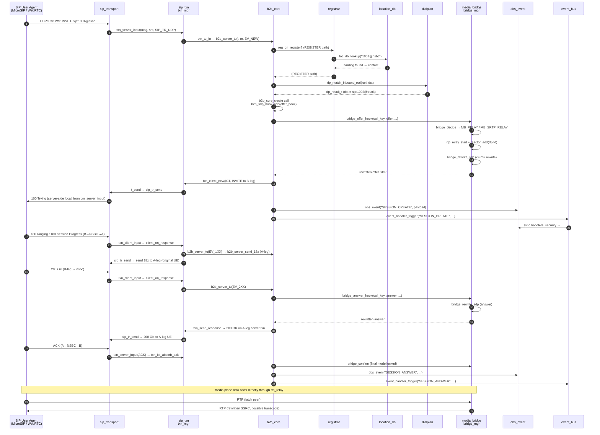
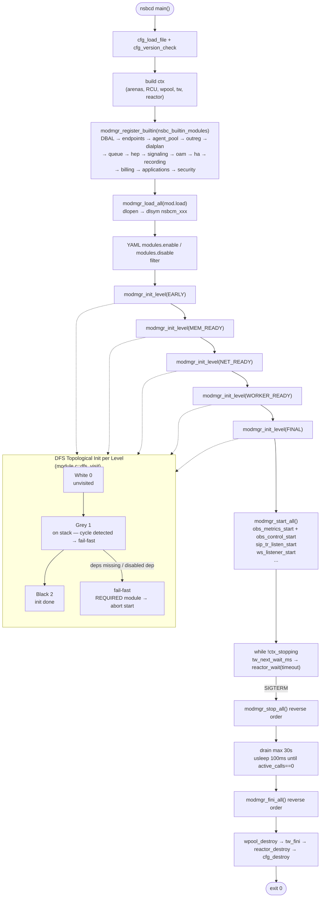
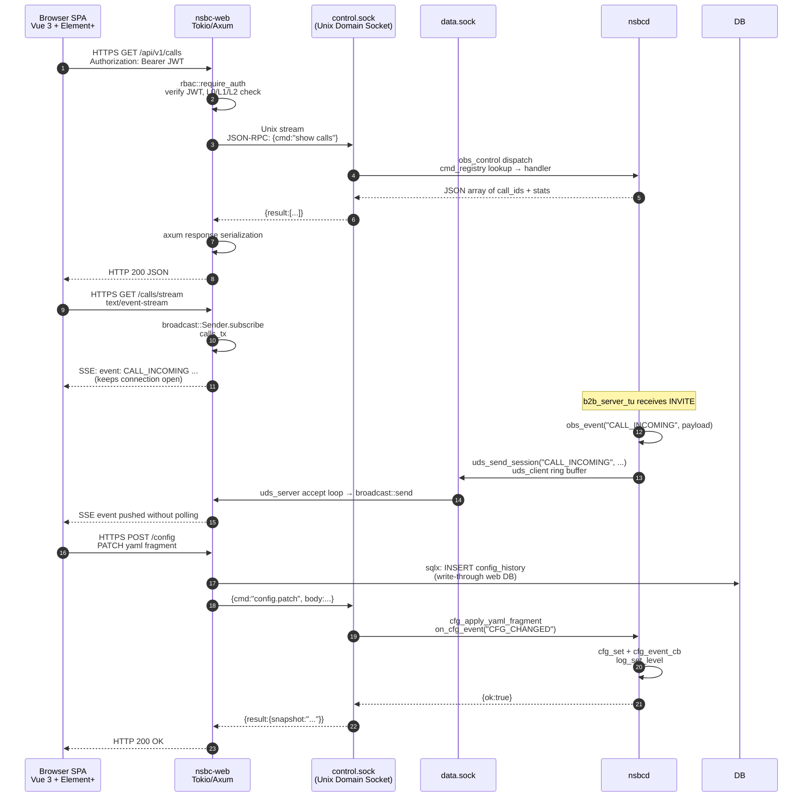

# NSBC Architecture Reference

This document synthesizes the C core (`nsbcd`) and the Rust management sidecar (`nsbc-web`) into
a single architecture view derived from the current source tree (`src/**`, `web/**`). Every
diagram uses real function / type names from the C and Rust sources, and every module in the
dependency matrix has been verified against `builtin.c` and the `NSBC_MOD_CAT` descriptors.

---

## 1. System Block Architecture

```mermaid
graph TD
    subgraph "Rust Sidecar — nsbc-web (separate process)"
        direction LR
        AX[AxeT Router<br/>axum 0.7 / tokio]
        AUTH[AuthSvc<br/>argon2id + JWT]
        DB[sqlx Db<br/>SQLite/MySQL/Postgres]
        RBAC[RBAC middleware<br/>L0/L1/L2]
        CORECLI[CoreApi client<br/>HTTP + UDS]
        AX --> AUTH --> RBAC --> CORECLI
        CORECLI --> DB
    end

    subgraph "Unix Domain Sockets"
        CTRL[control.sock<br/>OAM commands]
        DATA[data.sock<br/>C→Web events]
    end

    subgraph "C Core — nsbcd (single multi-threaded process)"
        direction TB

        subgraph Core["Core Foundation"]
            CFG[cfg.c<br/>YAML node tree<br/>pthread_rwlock]
            MOD[module.c<br/>DFS topology init<br/>dlopen dynamic .so]
            RCU[mem_rcu.c<br/>RCU deferral]
            MEM[mem_arena.c<br/>5-domain arenas]
            LOG[log.c<br/>audit + ring]
        end

        subgraph Signaling["Signaling Assembly<br/>(signaling.c — single wiring point)"]
            PORT[port_table.c<br/>RTP port allocator]
            BRIDGE[media_bridge.c<br/>bridge_mgr]
            LOC[location_db.c<br/>AoR → contact bindings]
            DLG[sip_dialog.c<br/>dlg_mgr]
            TXN[sip_txn.c<br/>txn_mgr (64 shards)]
            B2B[b2bua.c<br/>b2b_core (1024 shards)]
            TR[sip_transport.c<br/>UDP/TCP/TLS/WS]
            REG[registrar.c<br/>reg_core + tbuckets]
        end

        subgraph ReactorThread["Main Reactor Thread (epoll)"]
            RE[reactor.c<br/>epoll reactor]
            TW[tw.c<br/>timer wheel]
            RE -->|tw_next_wait_ms| TW
        end

        subgraph Workers["Worker Pool (N threads, hw-concurrency)"]
            WP[worker.c<br/>wpool (MPSC queues)]
        end

        subgraph EventBus["Event Bus"]
            EB[event_bus.c<br/>per-core ring<br/>sync handler chain]
        end

        subgraph OAM["OAM Layer"]
            OBS[oam_module.c<br/>obs_metrics / obs_control]
            UDSC[uds_client.c<br/>→ Web data.sock]
            PB[playback_engine.c]
            VAD[vad_engine.c]
        end

        subgraph MediaPath["Media Fast Path (inside reactor)"]
            RELAY[rtp_relay_t<br/>bypass | relay | transcode | SRTP_RELAY]
            DTLS[dtls_srtp.c]
            SSRC[ssrc_policy.c]
        end

        subgraph Mods["Business Modules (src/mod/*)"]
            DPLAN[dialplans/dialplan.c]
            EP[endpoints/endpoints.c]
            BILL[billing/cdr.c]
            REC[recording/recording.c]
            SEC[security/security.c]
            APP[applications/applications.c]
            AI[ai_dialog/ai_dialog.c<br/>asr_tts]
            OREG[outbound_reg/outbound_reg.c]
            HEP[hep_sink.c]
            PRES[presence/presence.c]
        end
    end

    AX <-->|REST /metrics / /api/v1| CTRL
    OBS -->|command| CTRL
    OBS -->|event JSON| UDSC --> DATA
    UDSC -.->|/var/run/nsbc/data.sock| AX

    MOD --> CFG
    MOD --> RCU
    MOD --> MEM
    MOD --> LOG
    MOD --> Signaling
    MOD --> OAM
    MOD --> Mods

    RE --> TR
    TR --> TXN
    TXN --> B2B
    B2B --> REG
    B2B --> BRIDGE
    B2B --> LOC
    B2B --> DLG
    BRIDGE --> PORT
    BRIDGE --> RELAY

    B2B -->|event_handler_trigger| EB
    B2B -->|nsbc_event_push| EB
    B2B -.->|b2b_sdp_hook_add| BRIDGE
    B2B -.->|b2b_call_destroy_add| Mods
    B2B -.->|b2b_cdr_hook_add| BILL
    BRIDGE -.->|bridge_add_rec_feed_hook| REC
    BRIDGE -.->|bridge_add_rec_feed_hook| AI

    WP -.->|wpool_submit| B2B
    WP -.->|wpool_submit| BRIDGE

    REG -->|reg_on_register| TXN
    REG -->|b2b_register_hook_add| B2B

    style Core fill:#f3f6fa
    style Signaling fill:#e8f0fe
    style OAM fill:#fff4e5
    style Mods fill:#fef7e0
    style MediaPath fill:#e8faf0
```

**Layering rule enforced at link time (REQ-ARCH-011 / builtin.c):**

- `MOD_L_EARLY` → `MOD_L_MEM_READY` → `MOD_L_NET_READY` → `MOD_L_WORKER_READY` → `MOD_L_FINAL`
- Call-path modules (`MOD_F_CALL_PATH`: signaling, hep) are static-only and never dlopen'd.
- Required modules (`MOD_F_REQUIRED`: endpoints, agent_pool, queue, signaling, oam) fail-fast
  on init or start failure.

---

## 2. SIP Transaction State Machine

```mermaid
stateDiagram-v2
    direction LR
    %% Client branch top, Server bottom

    subgraph Client[Client-side (UAC)]
        direction TB
        c_IDLE
        c_ICT_CALLING --> c_ICT_PROCEEDING: provisional 1xx
        c_ICT_PROCEEDING --> c_ICT_COMPLETED: final 2xx
        c_ICT_PROCEEDING --> c_ICT_COMPLETED: final 3xx-6xx
        c_ICT_CALLING --> c_ICT_COMPLETED: final response
        c_ICT_COMPLETED --> c_ICT_TERMINATED: D (32s) or BYE
        c_IDLE --> c_ICT_CALLING: txn_client_new (INVITE)

        c_NICT_TRYING --> c_NICT_PROCEEDING: provisional 1xx
        c_NICT_PROCEEDING --> c_NICT_COMPLETED: final response
        c_NICT_TRYING --> c_NICT_COMPLETED: final response
        c_NICT_COMPLETED --> c_NICT_TERMINATED: D timer
        c_IDLE --> c_NICT_TRYING: txn_client_new (non-INVITE)
    end

    subgraph Server[Server-side (UAS)]
        direction TB
        s_IDLE
        s_IST_PROCEEDING --> s_IST_COMPLETED: 2xx sent
        s_IST_COMPLETED --> s_IST_CONFIRMED: ACK received
        s_IST_CONFIRMED --> s_IST_TERMINATED: H (64s) or BYE
        s_IDLE --> s_IST_PROCEEDING: txn_server_input (INVITE)

        s_NIST_TRYING --> s_NIST_PROCEEDING: provisional
        s_NIST_PROCEEDING --> s_NIST_COMPLETED: final sent
        s_NIST_COMPLETED --> s_NIST_TERMINATED: I/J/K timers
        s_IDLE --> s_NIST_TRYING: txn_server_input (non-INVITE)
    end

    %% Retransmit timers (A/B/E/F/G) via tw_node_t tm_retr
    %% Dead timers (D/H/I/J/K) via tw_node_t tm_dead
```

Relevant source identifiers ([sip_txn.c](../src/sip/sip_txn.c)):
- State enum: `TXN_ICT_CALLING`, `TXN_ICT_PROCEEDING`, `TXN_ICT_COMPLETED`,
  `TXN_ICT_TERMINATED`, `TXN_NICT_TRYING`, `TXN_NICT_PROCEEDING`,
  `TXN_NICT_COMPLETED`, `TXN_NICT_TERMINATED`, `TXN_IST_PROCEEDING`,
  `TXN_IST_COMPLETED`, `TXN_IST_CONFIRMED`, `TXN_IST_TERMINATED`,
  `TXN_NIST_TRYING`, `TXN_NIST_PROCEEDING`, `TXN_NIST_COMPLETED`,
  `TXN_NIST_TERMINATED`.
- Timers: `tm_retr` (A/E/G) and `tm_dead` (B/F/H/D/I/J/K) are both `tw_node_t`
  members of `struct sip_txn`, armed on the global time wheel (`ctx->tw`) from
  `t_send` and `cb_retr`/`cb_dead`.
- API: `txn_mgr_create`, `txn_client_new`, `txn_client_input`,
  `txn_server_input`, `txn_send_response`.

---

## 3. B2BUA Call Setup Sequence



Key function / type names verified:
- `b2b_server_tu`, `handle_new_invite`, `b2b_core_create`, `b2b_originate` (outbound path),
  `b2b_call_destroy_add` (end-hook registration).
- `bridge_offer_hook`, `bridge_answer_hook`, `bridge_confirm`, `bridge_rewrite_sdp`,
  `rtp_relay_start`, `rtp_relay_stop`.
- Signaling assembly is a single wiring-point file
  ([src/core/signaling.c](../src/core/signaling.c)) — it builds `sig_runtime_t`
  (`ptable`, `bridge`, `loc`, `dlg`, `txn`, `b2b`, `tr`, `reg`, `dp_ctx`) and
  wires callbacks between them.

---

## 4. Media Bridge Pipeline

```mermaid
graph LR
    subgraph "SDP Plane (reactor thread, synchronous)"
        Offer["B-leg SDP offer<br/>(WebRTC DTLS / plain SIP)"]
        BHOOK["bridge_offer_hook<br/>(b2b_sdp_hook_add)"]
        Decide["bridge_decide<br/>policy + SDP inspection"]
        Answer["A-leg SDP answer"]
        AHOOK["bridge_answer_hook"]
        Confirm["bridge_confirm<br/>final mode locked"]
    end

    subgraph "Mode"
        direction TB
        MB_BYPASS["MB_BYPASS<br/>no ports allocated<br/>SDP pass-through"]
        MB_RELAY["MB_RELAY<br/>SSRC whitelist + rewrite<br/>RTCP observe + forward"]
        MB_TRANSCODE["MB_TRANSCODE<br/>G.711A↔G.711U<br/>transcode_sess_t"]
        MB_SRTP_RELAY["MB_SRTP_RELAY<br/>DTLS-SRTP endpoints<br/>libsrtp2 session"]
    end

    subgraph "RTP Forwarding (epoll reactor thread)"
        direction TB
        SOCK_A["fd_rtp[0] / fd_rtcp[0]<br/>side A peer"]
        SOCK_B["fd_rtp[1] / fd_rtcp[1]<br/>side B peer"]
        LATCH["comedia latch<br/>on first inbound packet"]
        SSRC_POL["ssrc_policy<br/>whitelist learned from SDP"]
        SSRC_RW["smap_t<br/>in→out SSRC rewrite"]
        FEC["media_fec<br/>forward error correction"]
        JBUF["jitter_buf<br/>in-order reassembly"]
        REC["rec_feed_fn + rec_hooks<br/>(recording, ai_dialog)"]
        OBS["atomic RTP stats<br/>d_in_ssrc[2], d_rtp_jitter_ticks[2]<br/>RTCP RR fraction/lost/jitter"]
    end

    subgraph "DTLS / SRTP"
        DTLS_S["dtls_server<br/>(WebRTC side)"]
        SRTP["nsbc_srtp_sess_t<br/>libsrtp2"]
    end

    Offer --> BHOOK --> Decide --> AHOOK --> Answer --> Confirm
    Decide --> MB_BYPASS
    Decide --> MB_RELAY
    Decide --> MB_TRANSCODE
    Decide --> MB_SRTP_RELAY

    Confirm --> SOCK_A
    Confirm --> SOCK_B
    MB_SRTP_RELAY --> DTLS_S --> SRTP --> SOCK_A
    MB_TRANSCODE -.-> "transcode_sess[side]"
    MB_RELAY --> SSRC_POL --> LATCH --> SSRC_RW --> JBUF --> FEC --> REC --> OBS

    style SDP Plane fill:#e8f0fe
    style Mode fill:#fff4e5
    style "RTP Forwarding (epoll reactor thread)" fill:#e8faf0
    style "DTLS / SRTP" fill:#f7f0fe
```

Source identifiers ([media_bridge.c](../src/media/bridge/media_bridge.c),
[media_bridge.h](../src/include/media_bridge.h)):
- Modes: `MB_BYPASS`, `MB_RELAY`, `MB_TRANSCODE`, `MB_SRTP_RELAY`.
- Primary call-site: `b2b_sdp_hook_add(kind=B2B_SDP_OFFER/ANSWER, bridge_offer_hook/bridge_answer_hook)`.
- Structures: `cnode_t` (per-call bridge node), `rtp_relay_t` (per-relay state),
  `bridge_mgr_t` (64 shards), `smap_t` (SSRC rewrite, 16 slots with "hint" optimization).
- Diagnostics (`mb_view_t`): latched, ssrc_in/out, rtcp rr, rtp seq-gap counts,
  SSRC↔CNAME binding, inject_drops for unauthorized SSRC.

---

## 5. Module Lifecycle Flow



Key facts from the source:
- Module levels (`mod_level_t`): `MOD_L_EARLY` (0), `MOD_L_MEM_READY` (1),
  `MOD_L_NET_READY` (2), `MOD_L_WORKER_READY` (3), `MOD_L_FINAL` (4).
- The builtin list in [builtin.c](../src/core/builtin.c) hard-codes the required
  modules with their registration order (DBAL, endpoints, agent_pool, outreg,
  dialplan, queue, hep, signaling, oam, ha, recording, billing, applications, security).
- Each module descriptor (`nsbc_module_t`) lists `deps[0..ND-1]` and the DFS
  visitor (`dfs_visit`) in [module.c](../src/core/module.c) validates and sorts.
- `oam` declares dependencies on `{signaling}`, `queue` on `{agent_pool}`,
  `billing` / `security` on `oam` (they need `cmd_registry` created during oam init).

---

## 6. Thread / Concurrency Model

```mermaid
graph TD
    subgraph "nsbcd — C Core"
        Main["Main / Reactor Thread (1 epoll loop)<br/>reactor_wait(ctx.re, timeout)<br/>timeout = min(tw_next_wait_ms, 1000ms)"]
        Ticker["Ticker Thread<br/>pthread_cond_timedwait MONOTONIC<br/>→ tw_advance(ctx.tw, now)<br/>→ wpool_rcu_advance (every ~1s)"]
        Workers["Worker Pool (N = hw-concurrency)<br/>worker_main spins on mem_mpsc_pop<br/>sched_yield → nanosleep 200us backoff<br/>RCU reader join per thread"]

        subgraph "RCU"
            RCU[mem_rcu_t<br/>reactor is writer<br/>workers are readers]
        end

        subgraph "Timer Wheel"
            TW["tw_t 100ms tick<br/>arm(t->tm_retr)<br/>arm(t->tm_dead)<br/>SessTimer refresh/expire nodes"]
        end

        subgraph "Per-Core Event Bus"
            EB_R[per_core_ring<br/>write_pos only atomic_store<br/>read_pos atomic_load acquire<br/>g_global_seq __atomic_fetch_add]
        end

        Main -->|epoll_wait| TW
        Main -->|reactor_add(rtp fd)| Media
        Main -->|reactor_add(UDP fd)| SIP_Tr
        Main -->|reactor_add(WS fd)| WS
        Main -->|reactor_add(signal fd)| Signal

        Ticker -->|tw_advance| TW
        Ticker -->|wpool_rcu_advance| RCU

        Workers -->|wpool_submit(hash_key)| B2B_shard
        Workers -->|wpool_submit_any| Bridge_shard

        subgraph "Sharded Tables (pthread_mutex per shard)"
            B2B_shard["b2b_core.sh[1024]<br/>call_link_t head"]
            TXN_shard["txn_mgr.sh[64]<br/>hash chain by branch+method+kind"]
            Bridge_shard["bridge_mgr.sh[64]<br/>cnode_t head"]
            Reg_shard["reg_core.tbucket ip[4096]<br/>aor[4096] token-bucket"]
        end

        Main --> B2B_shard
        Main --> TXN_shard
        Main --> Bridge_shard
        Main --> Reg_shard

        RCU -->|RCU protected ptrs| RT["ctx->rt<br/>route_table RCU atomic reload"]
        Main -->|RCU writer| RT
        Workers -->|RCU readers| RT

        EB_R["B2B reactor thread<br/>emit nsbc_event_push<br/>→ per-core TLS buffer → ring"]
    end
```

Concurrency rules enforced by the source:

| Structure              | Locking                                                 |
|------------------------|---------------------------------------------------------|
| `b2b_core.sh[1024]`    | `pthread_mutex_t` per shard (call insert/lookup/delete)  |
| `txn_mgr.sh[64]`       | `pthread_mutex_t` per shard; txn `refs` atomic          |
| `bridge_mgr.sh[64]`    | `pthread_mutex_t` per shard                             |
| `reg_core.tbucket_t`   | `pthread_mutex_t` per bucket, token-bucket rate limit   |
| `route_table_t *`      | RCU (`mem_rcu_t`), `ctx->rt` atomically swapped          |
| Event bus ring         | lock-free: single writer per core, atomic pos only       |
| Workers                | lock-free MPSC queues (one queue per worker thread)      |

- All SIP signaling path execution (UDP/TCP/TLS/WS receive → transport → txn →
  b2bua → response) happens **synchronously inside the reactor thread** (REQ-ARCH-015,
  comment in [b2bua.c](../src/sip/b2bua.c): "call link fully synchronous on reactor thread").
- The worker pool is used for **asynchronous background** tasks (dialplan dp_sleep,
  recording transcode, VAD engine, outbound originate with sequential bridge wait).

---

## 7. Web Sidecar ↔ Core Communication



Source identifiers from [web/src/main.rs](../web/src/main.rs), [web/Cargo.toml](../web/Cargo.toml):
- Web tech stack: Tokio 1 multi-thread runtime + Axum 0.7 (no Actix-Web, `#![deny(unsafe_code)]`).
- UDS paths (hard-coded, not configurable): `/var/run/nsbc/control.sock` (OAM commands) and
  `/var/run/nsbc/data.sock` (C→Web write-through events).
- Event broadcast channels: `AppState.calls_tx` (cap 256, SESSION real-time),
  `AppState.vad_tx` (cap 1024, VAD_EVENT for AI barge-in).
- Web has `sqlx` optional DB connection (restricted account from a separate DB schema, only
  CDR/audit/config_history writes; per REQ-WEB-013 the core never accesses this DB directly).

---

## 8. Registrar Registration Flow

```mermaid
sequenceDiagram
    autonumber
    participant UA as SIP User Agent<br/>(MicroSIP, JsSIP, WS)
    participant TR as sip_transport<br/>(UDP / WSS)
    participant TX as sip_txn<br/>txn_server_input
    participant REG as registrar<br/>reg_core
    participant EP as endpoints<br/>HA1 lookup
    participant DB as location_db
    participant EB as event_bus
    participant UDS as uds_client

    UA->>TR: REGISTER sip:nsbc CSeq: 1<br/>Contact: sip:user@ua-ip:5060;expires=3600
    TR->>TX: txn_server_input(msg, src, proto)
    TX->>REG: reg_on_register(proto, src, msg)
    REG->>REG: tb_take(ip[key], cps)<br/>tb_take(aor[key], cps)<br/>global_take()
    alt rate limit exceeded
        REG-->>TX: 403 Forbidden (rate-limit)
        TX-->>TR: sip_tr_send → 403
        TR-->>UA: 403 Forbidden
        REG->>EB: nsbc_event_push("REGISTER_FAIL", ...)
    else rate OK
        REG->>REG: parse auth: realm nonce uri response
        REG->>EP: ep_lookup_ha1("user", "nsbc")
        alt auth missing or fail
            REG-->>TX: 401 Unauthorized<br/>WWW-Authenticate: Digest realm=...
            TX-->>TR: sip_tr_send → 401
            TR-->>UA: 401
            REG->>EB: event_handler_trigger("AUTH_FAIL", ...)<br/>b2b_guard_notify → security
        else auth OK
            REG->>DB: loc_db_upsert("aor=user@nsbc",<br/>contact, expires, reg_id)
            DB-->>REG: binding stored (or updated)
            REG-->>TX: 200 OK<br/>Contact: ... expires=3600<br/>Date: ...
            TX-->>TR: sip_tr_send → 200
            TR-->>UA: 200 OK
            REG->>EB: event_handler_trigger("REGISTER_OK", ...)
            REG->>EB: nsbc_event_push("REGISTER_OK", payload_json)
            EB->>UDS: uds_send_session("REGISTER_OK", ...)
            UDS->>UDS: ring buffer → Web data.sock
        end
    end
```

Source identifiers from [registrar.c](../src/registrar/registrar.c):
- `reg_core_create`, `reg_on_register`, tbucket rate limiters: `TB_IP_N=4096`, `TB_AOR_N=4096`,
  plus `glock` + `gtokens` global limiter.
- Registration dispatch goes through `txn_server_input` (REGISTER uses NIST state machine),
  so the registrar's responses piggy-back on the existing transaction retransmit timers.
- The registrar calls `b2b_guard_notify` (auth-fail path) which feeds the `security`
  module's per-IP CIDR / UA block list.

---

## Module Dependency Matrix

A `✓` in `B depends on A` means `B`'s descriptor lists `A` in its `deps[]`, or the
code path in `A` directly calls / invokes `B`'s public API. Column headings are the
major modules from `builtin.c` and `src/mod/*`.

| Module / depends-on | DBAL | endpoints | agent_pool | outreg | dialplan | queue | hep | signaling | oam | ha | recording | billing | applications | security | media_bridge | registrar | location_db | txn_mgr | sip_transport | b2bua | event_bus | obs | wpool | tw | reactor | RCU |
|---------------------|------|-----------|------------|--------|----------|-------|-----|-----------|-----|----|-----------|---------|--------------|----------|-------------|-----------|-------------|---------|---------------|-------|-----------|-----|-------|----|---------|-----|
| **signaling**       |      | ✓         |            |        |          |       |     |           |     | ✓  | ✓         |         |              |          | ✓           | ✓         | ✓           | ✓       | ✓             | ✓     |           |     |       | ✓  | ✓       | ✓   |
| **b2bua**           |      | ✓         |            | ✓      | ✓        | ✓     |     |           |     |    | ✓         | ✓       | ✓            | ✓        | ✓           | ✓         | ✓           | ✓       | ✓             | ✓     | ✓         |     | ✓     | ✓  | ✓       | ✓   |
| **registrar**       |      | ✓         |            |        |          |       |     |           |     |    |           |         |              | ✓        |             |           | ✓           | ✓       | ✓             |       | ✓         |     |       | ✓  | ✓       |     |
| **media_bridge**    |      |           |            |        |          |       | ✓   |           |     |    | ✓         |         |              |          |             |           |             |         |               |       |           |     |       | ✓  | ✓       |     |
| **sip_txn**         |      |           |            |        |          |       |     |           |     |    |           |         |              |          |             |           |             |         |               |       |           |     |       | ✓  |         |     |
| **sip_transport**   |      |           |            |        |          |       |     |           |     |    |           |         |              |          |             |           |             |         |               |       |           |     |       | ✓  | ✓       |     |
| **oam**             |      |           |            |        |          |       |     | ✓         |     |    |           |         |              |          |             |           |             |         |               |       |           | ✓   |       |    |         |     |
| **billing**         |      |           |            |        |          |       |     |           | ✓    |    |           |         |              |          |             |           |             |         |               |       |           |     |       |    |         |     |
| **security**        |      |           |            |        |          |       |     |           | ✓    |    |           |         |              |          |             |           |             |         |               |       |           |     |       |    |         |     |
| **applications**    |      |           |            |        | ✓        |       |     |           | ✓    |    |           |         |              |          |             |           |             |         |               |       |           |     |       |    |         |     |
| **recording**       |      |           |            |        |          |       |     |           |      |    |           |         |              |          | ✓           |           |             |         |               |       |           |     |       |    |         |     |
| **dialplan**        |      |           |            |        |          |       |     |           |      |    |           |         |              |          |             |           |             |         |               |       |           |     |       |    |         |     |
| **queue**           |      |           | ✓          |        |          |       |     |           |      |    |           |         |              |          |             |           |             |         |               |       |           |     |       |    |         |     |
| **ha**              |      | ✓         |            |        |          |       |     | ✓         | ✓    |    |           |         |              |          |             |           |             |         |               |       |           | ✓   |       |    |         | ✓   |
| **agent_pool**      |      | ✓         |            |        |          |       |     |           |      |    |           |         |              |          |             |           |             |         |               |       |           |     |       |    |         |     |
| **outreg**          |      |           |            |        |          |       |     |           |      |    |           |         |              |          |             |           |             |         |               |       |           |     |       |    |         |     |
| **endpoints**       |      |           |            |        |          |       |     |           |      |    |           |         |              |          |             |           |             |         |               |       |           |     |       |    |         |     |
| **event_bus**       |      |           |            |        |          |       |     |           |      |    |           |         |              |          |             |           |             |         |               |       |           |     |       |    |         |     |
| **wpool**           |      |           |            |        |          |       |     |           |      |    |           |         |              |          |             |           |             |         |               |       |           |     |       |    |         | ✓   |

**Notes:**

- `signaling` is the **sole wiring point** (REQ-ARCH-010/011). It owns all eight heavy objects
  (`ptable`, `bridge`, `loc`, `dlg`, `txn`, `b2b`, `tr`, `reg`) stored in `sig_runtime_t`, and
  everything else touches them through signaling-initiated callback chains rather than
  cross-module `#include` of each other's implementation files.
- The `oam` module declares `deps = {"signaling"}` because signaling creates the reactor,
  time wheel, worker pool and signal handler before oam's `start`. `billing` and
  `security` depend on `oam` because they register commands with `obs_cmd_registry`
  during their own `init`, which must happen after `oam_init` creates it.
- `rcu` is only in a tiny top row because only signaling creates the RCU (`mem_rcu_create`
  in main.c) and only `route_table` reload uses it; the rest of the modules do not deal
  with RCU directly.
- `event_bus` has **no static callers** at compile time — it is a runtime hook chain
  (`b2b_sdp_hook_add`, `b2b_cdr_hook_add`, `b2b_guard_hook_add`,
  `bridge_add_rec_feed_hook`, `event_handler_register`). This is the explicit contract
  documented in [event_bus.h](../src/include/event_bus.h):
  "Registry Hook Chain (sync) — security interceptor / registrar handler / SDP offer
  rewrite   Event Bus Ring (async) — CDR emit / monitor observation / alert notification".
- Modules with `MOD_F_CALL_PATH` (`hep`, `signaling`) are always static-linked;
  all others may be `dlopen`'d from `mod.load`. The table above omits dynamically
  loaded optional modules (`ai_dialog`, `asr_tts`, `media_bug`, `hello`,
  `presence`, `playback`, `codecs`, `av`, `formats`, `cachedb`, `outreg`, `callcenter`)
  because they are runtime opt-ins whose dependencies are checked at `dlopen` time.
