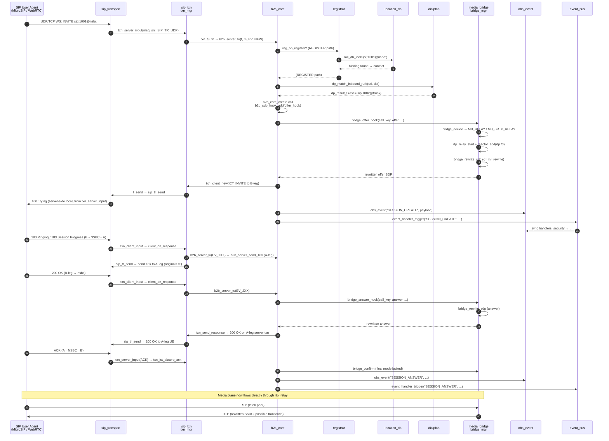
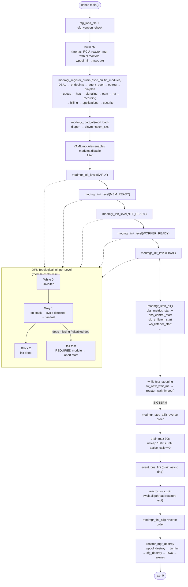
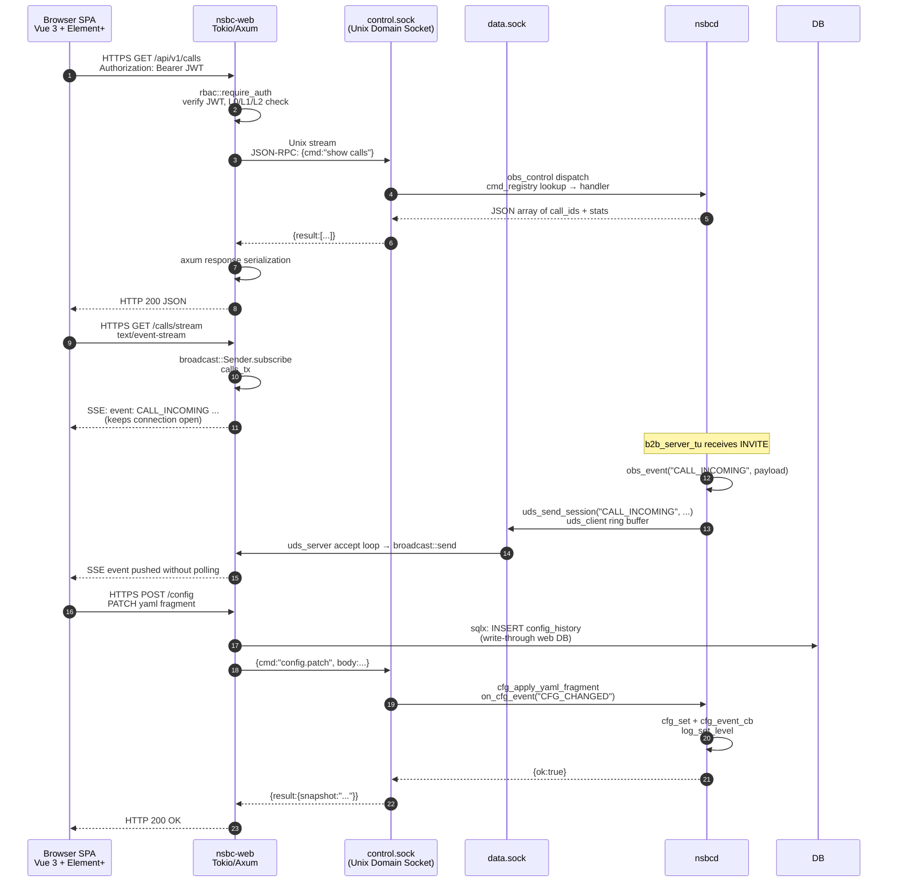

# NSBC Architecture Reference

This document synthesizes the C core (`nsbcd`) and the Rust management sidecar (`nsbc-web`) into
a single architecture view derived from the current source tree (`src/**`, `web/**`). Every
diagram uses real function / type names from the C and Rust sources, and every module in the
dependency matrix has been verified against `builtin.c` and the `NSBC_MOD_CAT` descriptors.

---

## 1. System Block Architecture

```mermaid
graph TD
    subgraph WEB["Rust Sidecar — nsbc-web (separate process)"]
        direction LR
        AX[AxeT Router<br/>axum 0.7 / tokio]
        AUTH[AuthSvc<br/>argon2id + JWT]
        DB[sqlx Db<br/>SQLite/MySQL/Postgres]
        RBAC[RBAC middleware<br/>L0/L1/L2]
        CORECLI[CoreApi client<br/>HTTP + UDS]
        AX --> AUTH --> RBAC --> CORECLI
        CORECLI --> DB
    end

    subgraph UDS["Unix Domain Sockets"]
        CTRL[control.sock<br/>OAM commands]
        DATA[data.sock<br/>C→Web events]
    end

    subgraph CCORE["C Core — nsbcd (single multi-threaded process)"]
        direction TB

        subgraph Core["Core Foundation"]
            CFG[cfg.c<br/>YAML node tree<br/>pthread_rwlock]
            MOD[module.c<br/>DFS topology init<br/>dlopen dynamic .so]
            RCU[mem_rcu.c<br/>RCU deferral]
            MEM[mem_arena.c<br/>5-domain arenas]
            LOG[log.c<br/>audit + ring]
        end

        subgraph Signaling["Signaling Assembly<br/>(signaling.c — single wiring point)"]
            PORT[port_table.c<br/>RTP port allocator]
            BRIDGE[media_bridge.c<br/>bridge_mgr]
            LOC[location_db.c<br/>AoR → contact bindings]
            DLG[sip_dialog.c<br/>dlg_mgr]
            TXN["sip_txn.c<br/>txn_mgr (64 shards)"]
            B2B["b2bua.c<br/>b2b_core (1024 shards)"]
            TR[sip_transport.c<br/>UDP/TCP/TLS/WS]
            REG[registrar.c<br/>reg_core + tbuckets]
        end

        subgraph ReactorManager["Reactor Manager — reactor_manager.c"]
            direction LR
            RMGR["reactor_mgr<br/>N epoll reactors<br/>hash(rtp_port) % N 路由"]
            R0["reactor[0]<br/>(main thread, ticker coupled)"]
            R1["reactor[1]<br/>(pthread, CPU pin)"]
            RN["reactor[N-1]<br/>(pthread, CPU pin)"]
            RMGR --> R0
            RMGR --> R1
            RMGR --> RN
        end

        subgraph TimerThread["Timer Wheel Driver Thread"]
            TW[timer_wheel.c<br/>timer wheel]
        end

        RMGR -.->|wait timeout from tw_next_wait_ms| TW
        TimerThread -.->|tw_advance; callbacks currently execute here| TW

        subgraph Workers["Worker Pool — worker.c"]
            WP["wpool (MPSC queues)<br/>min→max dynamic scale<br/>64-slot prealloc cap<br/>resize_lock serialized"]
        end

        subgraph EventBus["Event Bus"]
            EB[event_bus.c<br/>per-core ring<br/>sync handler chain]
        end

        subgraph OAM["OAM Layer"]
            OBS[oam_module.c<br/>obs_metrics / obs_control]
            UDSC[uds_client.c<br/>→ Web data.sock]
            PB[playback_engine.c]
            VAD[vad_engine.c]
        end

        subgraph MediaPath["Media Fast Path (inside reactor)"]
            RELAY[rtp_relay_t<br/>bypass | relay | transcode | SRTP_RELAY]
            DTLS[dtls_srtp.c]
            SSRC[ssrc_policy.c]
        end

        subgraph Mods["Business Modules (src/mod/*)"]
            DPLAN[dialplans/dialplan.c]
            EP[endpoints/endpoints.c]
            BILL[billing/cdr.c]
            REC[recording/recording.c]
            SEC[security/security.c]
            APP[applications/applications.c]
            AI[ai_dialog/ai_dialog.c<br/>asr_tts]
            OREG[outbound_reg/outbound_reg.c]
            HEP[hep_sink.c]
            PRES[presence/presence.c]
        end
    end

    AX <-->|REST /metrics / /api/v1| CTRL
    OBS -->|command| CTRL
    OBS -->|event JSON| UDSC --> DATA
    UDSC -.->|/var/run/nsbc/data.sock| AX

    MOD --> CFG
    MOD --> RCU
    MOD --> MEM
    MOD --> LOG
    MOD --> Signaling
    MOD --> OAM
    MOD --> Mods

    RMGR --> TR
    TR --> TXN
    TXN --> B2B
    B2B --> REG
    B2B --> BRIDGE
    B2B --> LOC
    B2B --> DLG
    BRIDGE --> PORT
    BRIDGE --> RELAY

    B2B -->|event_handler_trigger| EB
    B2B -->|nsbc_event_push| EB
    B2B -.->|b2b_sdp_hook_add| BRIDGE
    B2B -.->|b2b_call_destroy_add| Mods
    B2B -.->|b2b_cdr_hook_add| BILL
    BRIDGE -.->|bridge_add_rec_feed_hook| REC
    BRIDGE -.->|bridge_add_rec_feed_hook| AI

    WP -->|bounded CDR persistence flush| BILL

    %% === Reactor ↔ Worker 交互（关键路径）===
    RMGR -->|"wpool_submit_any(hash_key, job)<br/>CDR WAL/spool flush offload<br/>reactor 线程不阻塞 I/O"| WP
    WP -->|"RCU reader: route_table 无锁读"| RCU
    RMGR -.->|"reactor_call(target, fn, arg)<br/>跨 reactor 投递（非 worker）"| RMGR
    WP -.->|SIP/media state machines remain owner-thread-bound| B2B

    REG -->|reg_on_register| TXN
    REG -->|b2b_register_hook_add| B2B

    style Core fill:#f3f6fa
    style Signaling fill:#e8f0fe
    style OAM fill:#fff4e5
    style Mods fill:#fef7e0
    style MediaPath fill:#e8faf0
```

**Layering rule enforced at link time (REQ-ARCH-011 / builtin.c):**

- `MOD_L_EARLY` → `MOD_L_MEM_READY` → `MOD_L_NET_READY` → `MOD_L_WORKER_READY` → `MOD_L_FINAL`
- Call-path modules (`MOD_F_CALL_PATH`: signaling, hep) are static-only and never dlopen'd.
- Required modules (`MOD_F_REQUIRED`: endpoints, agent_pool, queue, signaling, oam) fail-fast
  on init or start failure.

---

## 2. SIP Transaction State Machine

```mermaid
stateDiagram
    direction LR
    %% Client branch top, Server bottom

    subgraph Client["Client-side (UAC)"]
        direction TB
        c_IDLE
        c_ICT_CALLING --> c_ICT_PROCEEDING: provisional 1xx
        c_ICT_PROCEEDING --> c_ICT_COMPLETED: final 2xx
        c_ICT_PROCEEDING --> c_ICT_COMPLETED: final 3xx-6xx
        c_ICT_CALLING --> c_ICT_COMPLETED: final response
        c_ICT_COMPLETED --> c_ICT_TERMINATED: D (32s) or BYE
        c_IDLE --> c_ICT_CALLING: txn_client_new (INVITE)

        c_NICT_TRYING --> c_NICT_PROCEEDING: provisional 1xx
        c_NICT_PROCEEDING --> c_NICT_COMPLETED: final response
        c_NICT_TRYING --> c_NICT_COMPLETED: final response
        c_NICT_COMPLETED --> c_NICT_TERMINATED: D timer
        c_IDLE --> c_NICT_TRYING: txn_client_new (non-INVITE)
    end

    subgraph Server["Server-side (UAS)"]
        direction TB
        s_IDLE
        s_IST_PROCEEDING --> s_IST_COMPLETED: 2xx sent
        s_IST_COMPLETED --> s_IST_CONFIRMED: ACK received
        s_IST_CONFIRMED --> s_IST_TERMINATED: H (64s) or BYE
        s_IDLE --> s_IST_PROCEEDING: txn_server_input (INVITE)

        s_NIST_TRYING --> s_NIST_PROCEEDING: provisional
        s_NIST_PROCEEDING --> s_NIST_COMPLETED: final sent
        s_NIST_COMPLETED --> s_NIST_TERMINATED: I/J/K timers
        s_IDLE --> s_NIST_TRYING: txn_server_input (non-INVITE)
    end

    %% Retransmit timers (A/B/E/F/G) via tw_node_t tm_retr
    %% Dead timers (D/H/I/J/K) via tw_node_t tm_dead
```

Relevant source identifiers ([sip_txn.c](../src/sip/sip_txn.c)):
- State enum: `TXN_ICT_CALLING`, `TXN_ICT_PROCEEDING`, `TXN_ICT_COMPLETED`,
  `TXN_ICT_TERMINATED`, `TXN_NICT_TRYING`, `TXN_NICT_PROCEEDING`,
  `TXN_NICT_COMPLETED`, `TXN_NICT_TERMINATED`, `TXN_IST_PROCEEDING`,
  `TXN_IST_COMPLETED`, `TXN_IST_CONFIRMED`, `TXN_IST_TERMINATED`,
  `TXN_NIST_TRYING`, `TXN_NIST_PROCEEDING`, `TXN_NIST_COMPLETED`,
  `TXN_NIST_TERMINATED`.
- Timers: `tm_retr` (A/E/G) and `tm_dead` (B/F/H/D/I/J/K) are both `tw_node_t`
  members of `struct sip_txn`, armed on the global time wheel (`ctx->tw`) from
  `t_send` and `cb_retr`/`cb_dead`.
- API: `txn_mgr_create`, `txn_client_new`, `txn_client_input`,
  `txn_server_input`, `txn_send_response`.

---

## 3. B2BUA Call Setup Sequence



Key function / type names verified:
- `b2b_server_tu`, `handle_new_invite`, `b2b_core_create`, `b2b_originate` (outbound path),
  `b2b_call_destroy_add` (end-hook registration).
- `bridge_offer_hook`, `bridge_answer_hook`, `bridge_confirm`, `bridge_rewrite_sdp`,
  `rtp_relay_start`, `rtp_relay_stop`.
- Signaling assembly is a single wiring-point file
  ([src/core/signaling.c](../src/core/signaling.c)) — it builds `sig_runtime_t`
  (`ptable`, `bridge`, `loc`, `dlg`, `txn`, `b2b`, `tr`, `reg`, `dp_ctx`) and
  wires callbacks between them.

---

## 4. Media Bridge Pipeline

```mermaid
graph LR
    subgraph SDPPLANE["SDP Plane (reactor thread, synchronous)"]
        Offer["B-leg SDP offer<br/>(WebRTC DTLS / plain SIP)"]
        BHOOK["bridge_offer_hook<br/>(b2b_sdp_hook_add)"]
        Decide["bridge_decide<br/>policy + SDP inspection"]
        Answer["A-leg SDP answer"]
        AHOOK["bridge_answer_hook"]
        Confirm["bridge_confirm<br/>final mode locked"]
    end

    subgraph MODE["Mode"]
        direction TB
        MB_BYPASS["MB_BYPASS<br/>no ports allocated<br/>SDP pass-through"]
        MB_RELAY["MB_RELAY<br/>SSRC whitelist + rewrite<br/>RTCP observe + forward"]
        MB_TRANSCODE["MB_TRANSCODE<br/>G.711A↔G.711U<br/>transcode_sess_t"]
        MB_SRTP_RELAY["MB_SRTP_RELAY<br/>DTLS-SRTP endpoints<br/>libsrtp2 session"]
    end

    subgraph RTPFWD["RTP Forwarding (epoll reactor thread)"]
        direction TB
        SOCK_A["fd_rtp[0] / fd_rtcp[0]<br/>side A peer"]
        SOCK_B["fd_rtp[1] / fd_rtcp[1]<br/>side B peer"]
        LATCH["comedia latch<br/>on first inbound packet"]
        SSRC_POL["ssrc_policy<br/>whitelist learned from SDP"]
        SSRC_RW["smap_t<br/>in→out SSRC rewrite"]
        FEC["media_fec<br/>forward error correction"]
        JBUF["jitter_buf<br/>in-order reassembly"]
        REC["rec_feed_fn + rec_hooks<br/>(recording, ai_dialog)"]
        OBS["atomic RTP stats<br/>d_in_ssrc[2], d_rtp_jitter_ticks[2]<br/>RTCP RR fraction/lost/jitter"]
    end

    subgraph DTLS_SRTP["DTLS / SRTP"]
        DTLS_S["dtls_server<br/>(WebRTC side)"]
        SRTP["nsbc_srtp_sess_t<br/>libsrtp2"]
    end

    Offer --> BHOOK --> Decide --> AHOOK --> Answer --> Confirm
    Decide --> MB_BYPASS
    Decide --> MB_RELAY
    Decide --> MB_TRANSCODE
    Decide --> MB_SRTP_RELAY

    Confirm --> SOCK_A
    Confirm --> SOCK_B
    MB_SRTP_RELAY --> DTLS_S --> SRTP --> SOCK_A
    MB_TRANSCODE -.-> "transcode_sess[side]"
    MB_RELAY --> SSRC_POL --> LATCH --> SSRC_RW --> JBUF --> FEC --> REC --> OBS

    style SDPPLANE fill:#e8f0fe
    style MODE fill:#fff4e5
    style RTPFWD fill:#e8faf0
    style DTLS_SRTP fill:#f7f0fe
```

Source identifiers ([media_bridge.c](../src/media/bridge/media_bridge.c),
[media_bridge.h](../src/include/media_bridge.h)):
- Modes: `MB_BYPASS`, `MB_RELAY`, `MB_TRANSCODE`, `MB_SRTP_RELAY`.
- Primary call-site: `b2b_sdp_hook_add(kind=B2B_SDP_OFFER/ANSWER, bridge_offer_hook/bridge_answer_hook)`.
- Structures: `cnode_t` (per-call bridge node), `rtp_relay_t` (per-relay state),
  `bridge_mgr_t` (64 shards), `smap_t` (SSRC rewrite, 16 slots with "hint" optimization).
- Diagnostics (`mb_view_t`): latched, ssrc_in/out, rtcp rr, rtp seq-gap counts,
  SSRC↔CNAME binding, inject_drops for unauthorized SSRC.

---

## 5. Module Lifecycle Flow



Key facts from the source:
- Module levels (`mod_level_t`): `MOD_L_EARLY` (0), `MOD_L_MEM_READY` (1),
  `MOD_L_NET_READY` (2), `MOD_L_WORKER_READY` (3), `MOD_L_FINAL` (4).
- The builtin list in [builtin.c](../src/core/builtin.c) hard-codes the required
  modules with their registration order (DBAL, endpoints, agent_pool, outreg,
  dialplan, queue, hep, signaling, oam, ha, recording, billing, applications, security).
- Each module descriptor (`nsbc_module_t`) lists `deps[0..ND-1]` and the DFS
  visitor (`dfs_visit`) in [module.c](../src/core/module.c) validates and sorts.
- `oam` declares dependencies on `{signaling}`, `queue` on `{agent_pool}`,
  `billing` / `security` on `oam` (they need `cmd_registry` created during oam init).

---

## 6. Thread / Concurrency Model

```mermaid
graph TD
    subgraph NSBCD["nsbcd — C Core"]
        subgraph ReactorMgr["Reactor Manager — reactor_manager.c"]
            direction TB
            RMGR["reactor_mgr_create(n=cfg.core.reactors)"]
            RMGR --> R0["reactor[0]<br/>(main thread)<br/>ticker coupled<br/>epoll_wait(timeout)"]
            RMGR --> R1["reactor[1]<br/>(pthread_create)<br/>CPU pin 0"]
            RMGR --> RN["reactor[N-1]<br/>(pthread_create)<br/>CPU pin N-2"]
            R0 -->|"reactor_mgr_route(hash_key)<br/>hash(rtp_port[0]+rtp_port[1]*31)%N"| R1
            R0 -->|"reactor_call(target, fn, arg)<br/>跨 reactor 投递"| RN
        end

        subgraph Ticker["Ticker Thread"]
            T["pthread_cond_timedwait MONOTONIC<br/>→ tw_advance(ctx.tw, now)<br/>→ wpool_rcu_advance (~1s)"]
        end

        subgraph Workers["Worker Pool — worker.c"]
            direction TB
            WP["wpool_create(min, max=64, queue_cap, rcu)<br/>预分配 max_workers 槽位数组，永不 realloc"]
            WP --> SCALE["wpool_resize(new_n)<br/>resize_lock 串行化<br/>n_active atomic store"]
            WP --> SUBMIT["wpool_submit(hash_key, job)<br/>hash % n_active 路由到固定 worker<br/>slot_ready double-check"]
            WP --> SUBMIT_ANY["wpool_submit_any(job)<br/>RR + slot_ready 跳过死槽"]
            WP --> DRAIN["scale-down worker<br/>draining=1 + drain queue → self-exit<br/>线程退出只做 thread-local RCU leave"]
        end

        subgraph RCU["RCU"]
            RCU_T[mem_rcu_t<br/>reactors are writers<br/>workers are readers]
        end

        subgraph TW["Timer Wheel"]
            TW_T["tw_t 100ms tick<br/>arm(t->tm_retr)<br/>arm(t->tm_dead)<br/>SessTimer refresh/expire nodes"]
        end

        subgraph PCORE["Per-Core Event Bus"]
            EB_R[per_core_ring<br/>write_pos only atomic_store<br/>read_pos atomic_load acquire<br/>global_seq per-core local ++]
        end

        subgraph MediaPath["Media Fast Path (inside reactor)"]
            RELAY[rtp_relay_t<br/>bypass | relay | transcode | SRTP_RELAY]
            DTLS[dtls_srtp.c]
            SSRC[ssrc_policy.c]
        end

        subgraph SipTr["SIP Transport"]
            SIP_Tr_node["UDP/TCP/TLS/WS<br/>SO_REUSEPORT per reactor"]
        end

        subgraph WS_Li["WebSocket Listener"]
            WS_node["ws_listener.c"]
        end

        R0 -->|epoll_wait timeout = min(tw_next_wait_ms, 1000ms)| TW_T
        R0 -->|reactor_add(UDP fd SO_REUSEPORT)| SIP_Tr_node
        R1 -->|reactor_add(rtp fd per hash route)| RELAY
        RN -->|reactor_add(WS fd)| WS_node

        T -->|tw_advance| TW_T
        T -->|wpool_rcu_advance| RCU_T

        Mailbox["Bounded synchronous command mailbox<br/>4096 pending commands"] --> R0
        SUBMIT -->|"bounded CDR WAL/spool flush"| CDR_sink
        SUBMIT_ANY -->|"bounded CDR WAL/spool flush"| CDR_sink
        CDR_sink["billing CDR sink<br/>one serialized flush job"]

        %% === Reactor ↔ Worker 交互 ===
        R0 -->|"wpool_submit_any(hash_key, job)<br/>CDR flush offload<br/>reactor 线程不阻塞 I/O"| WP
        R1 -->|"wpool_submit(hash_key, job)<br/>hash % n_active 稳定 shard<br/>（稳定路由用于会话绑定任务）"| WP
        WP -->|"RCU reader: route_table 无锁读"| RCU_T
        WP -->|"submit 满队列回退: 同步 CDR flush"| R0

        subgraph SHARDS["Sharded Tables (pthread_mutex per shard)"]
            B2B_shard["b2b_core.sh[1024]<br/>call_link_t head"]
            TXN_shard["txn_mgr.sh[64] × 64 buckets<br/>branch+method+kind"]
            DLG_shard["dlg_mgr.sh[1024] × 32 buckets<br/>Call-ID+local-tag"]
            Bridge_shard["bridge_mgr.sh[64]<br/>cnode_t head"]
            Reg_shard["reg_core.tbucket ip[4096]<br/>aor[4096] token-bucket"]
            Loc_shard["location_db.sh[64] × 64 AoR buckets<br/>per-AoR contact chains"]
        end

        R0 --> B2B_shard
        R0 --> TXN_shard
        R0 --> DLG_shard
        R0 --> Bridge_shard
        R0 --> Reg_shard
        R0 --> Loc_shard
        R1 --> B2B_shard
        R1 --> TXN_shard

        RCU_T -->|RCU protected ptrs| RT["ctx->rt<br/>route_table RCU atomic reload"]
        R0 -->|RCU writer| RT
        R1 -->|RCU writer| RT
        Workers -->|RCU readers| RT

        EB_R["Each reactor thread<br/>emit nsbc_event_push<br/>→ per-core TLS buffer → ring"]
    end
```

**Reactor Manager** ([reactor_manager.c](../src/core/reactor_manager.c)):

- `reactor_mgr_create(n, max_events)` pre-creates all `n` reactor objects on the main thread before any module init. Default `n = 1` (backward compatible single-reactor mode); capped at 64. `reactor[0]` is reserved for the main thread (ticker time-wheel coupled); `reactor[1..n-1]` each run in their own pthread created by `reactor_mgr_start_threads()`.
- Each extra reactor thread calls `pthread_setaffinity_np` to pin itself to CPU core `(rid - 1)`. Pinning failure (container CPU quota insufficient) logs a warning and continues — never blocks startup.
- `reactor_mgr_route(mgr, hash_key)` computes `hash_key % n` to route a file descriptor (RTP relay, UDP socket, etc.) to a specific reactor. Single reactor (`n=1`) always returns 0, preserving legacy behavior. Routing keys are typically `rtp_port[0] + rtp_port[1] * 31` for RTP relay fd pairs or the IP hash for SIP transport sockets.
- SIP transport UDP listeners use `SO_REUSEPORT` — each reactor binds its own independent UDP socket; the kernel performs automatic load balancing across all bound sockets. New incoming SIP packets are dispatched to whichever reactor's socket receives them.
- `reactor_call(target, fn, arg)` is the **only** safe mechanism for cross-reactor operations. Never call `reactor_add`/`reactor_del` from a non-owner thread — always wrap with `reactor_call`. The caller retains argument memory until completion and must not hold locks needed by the target.
- **Owner audit**: `NSBC_REACTOR_OWNER_CHECK` compile-time macro enables debug assertions on `reactor_add`/`reactor_del` entry to verify the calling thread owns the reactor. Must be disabled in multi-reactor builds (the assertion would fire on every cross-thread call via `reactor_call`).
- **Exception call sites audited safe**: `media_bridge.c` (`rtp_relay_arm`/`rtp_relay_stop`) and `sip_transport.c` (`conn_close` inside `on_tcp_event`) — these run inside the reactor callback context = owner thread.
- **Shutdown ordering** (enforced by [main.c](../src/core/main.c)):
  ```
  SIGTERM → stop accepting new traffic → modmgr_stop_all() (call drain max 30s)
  → event_bus_fini() (drain async ring) → reactor_mgr_stop_all() (reactor_stop all)
  → reactor_mgr_join() (wait all pthread reactors exit & drain)
  → worker_pool_destroy() → timer_wheel_destroy() → reactor_mgr_destroy() (unified main-thread destroy)
  → modmgr_fini_all() reverse order → cfg_destroy → log_stop()
  ```
  **Critical**: `reactor_mgr_join()` **must** come after `modmgr_stop_all()` and event ring drain. Otherwise `rtp_relay_stop` may call `reactor_call()` targeting an already-destroyed reactor → use-after-free. The thread function `reactor_thread_fn` only drains and exits — it never calls `reactor_destroy` itself. All reactor resources are freed in one place (`reactor_mgr_destroy` on the main thread) after all reactor threads have joined.

**Worker Pool** ([worker.c](../src/core/worker.c)):

- `wpool_create(out, min_workers, max_workers, queue_cap, rcu)` creates a pool with pre-allocated `max_workers` slot entries (capped at 64, **never realloc**). Only the first `min_workers` slots are actually initialized with threads; the remaining slots are lazy-started via `wpool_resize`.
- `wpool_resize(new_n)` performs hot in-place scale-up or scale-down. All resize operations are serialized by a dedicated `resize_lock` mutex (separate from the submit gate). Scale-up initializes new slots (`worker_slot_init`) and starts threads; partial failure triggers rollback — slots marked `draining=1`, queue drained, thread joined, resources cleaned — **never cascading pool destroy**. Scale-down first atomically stores `n_active` to prevent new submissions from routing to dying slots, then marks targeted workers `draining=1`, posts a wakeup semaphore, and waits for them to drain their queues and exit (`pthread_join`). After join, the resize caller cleans up slot resources (MPSC queue, mem_pool, semaphore) — the worker thread itself only does thread-local RCU cleanup (`mem_rcu_thread_leave`) on exit, never touches pool shared state.
- Submission path is **lock-free**: reads `n_active` via `__atomic_load_n(..., ACQUIRE)`, computes `hash_key % n_active`, then double-checks `slot_ready` with another acquire-load. If a concurrent resize already killed that slot, it retries with a fresh `n_active`. `wpool_submit` routes by hash (stable shard for same call context); `wpool_submit_any` uses round-robin and skips dead slots (used for CDR WAL flush where order doesn't matter).
- Worker main loop blocks on `sem_t ready` when idle. On `draining=1` or shutdown, the loop exits when its queue becomes empty. Each worker owns its own MPSC queue, memory arena, and RCU reader slot.
- **Shutdown sequence**: `worker_close_submit_gate` (atomic OR CLOSING bit on `submit_state`, wait for in-flight submits to drain via condition variable) → `metric_source_unregister` (prevents late renders from dereferencing destroyed queue pointers) → `sem_post` all workers awake → `pthread_join` all started threads → clean up all slot resources → free pool.

**SIP Signaling Synchronous Execution** (REQ-ARCH-015, [b2bua.c](../src/sip/b2bua.c)):

All SIP signaling path execution (UDP/TCP/TLS/WS receive → transport → txn → b2bua → response) runs **synchronously inside the reactor thread that received the packet**. The reactor that binds a SO_REUSEPORT UDP socket is the reactor that processes SIP transactions from that socket. Cross-reactor SIP state access (txn_mgr, b2b_core, bridge_mgr, location_db) relies on per-shard `pthread_mutex_t` locks — no further synchronization needed beyond the existing shard locking. RTP relay fd pairs are explicitly routed to a fixed reactor via `reactor_mgr_route` at `rtp_relay_start` time.

**Reactor ↔ Worker Interaction Summary** (4 paths, verified in source):

| # | Direction | 函数 / 机制 | 路由策略 | 用途 |
|---|---|---|---|---|
| ① | Reactor → Worker | `wpool_submit_any(hash_key, job)` | round-robin + `slot_ready` 跳过死槽 | CDR WAL/spool flush — B2BUA 呼叫拆除时 reactor 线程调用，不阻塞 I/O |
| ② | Reactor → Worker | `wpool_submit(hash_key, job)` | `hash_key % n_active` → 固定 worker | 稳定 shard 任务（需要会话上下文在同一 worker 上的场景） |
| ③ | Worker → RCU | `mem_rcu_reader_t` (per-worker join) | 无锁 atomic acquire-load | route_table 无锁读 — Worker 执行 CDR flush 时需要读取当前拨号计划配置 |
| ④ | Reactor → Worker | 满队列回退 | `NSBC_NOSPC` → 同步 flush | worker submit queue 满时 CDR sink 回退为 reactor 线程内同步持久化，保证不丢数据 |

**跨 Reactor 操作**（非 worker 路径，附在此处便于对照）：

- `reactor_call(target, fn, arg)` — 把函数投递到目标 reactor 执行，唯一安全的跨 reactor 机制。调用方保留参数内存直到完成，不能持有目标需要的锁。返回 `NSBC_AGAIN` 表示目标 reactor 未启动稍后重试；返回 `NSBC_SHUTDOWN` 表示已停止。
- **绝对禁止**在非 owner 线程直接调用 `reactor_add` / `reactor_del` — 必须用 `reactor_call` 包装。
- RTP relay fd 通过 `reactor_mgr_route` 在 `rtp_relay_start` 时预路由到固定 reactor，后续所有媒体处理（`relay_recv_one`）都在该 reactor 上。

**Thread / Structure Locking Matrix** (verified in source):

| Structure              | Locking                                                 |
|------------------------|---------------------------------------------------------|
| `b2b_core.sh[1024]`    | `pthread_mutex_t` per shard (call insert/lookup/delete)  |
| `txn_mgr.sh[64]`       | `pthread_mutex_t` per shard; 64 hash buckets per shard; txn `refs` atomic |
| `dlg_mgr.sh[1024]`     | `pthread_mutex_t` per shard; 32 hash buckets per shard  |
| `location_db.sh[64]`   | `pthread_mutex_t` per shard; 64 AoR buckets per shard   |
| `bridge_mgr.sh[64]`    | `pthread_mutex_t` per shard                             |
| `reg_core.tbucket_t`   | `pthread_mutex_t` per bucket, token-bucket rate limit   |
| `route_table_t *`      | RCU (`mem_rcu_t`), `ctx->rt` atomically swapped          |
| Event bus ring         | lock-free: single writer per core, atomic pos only       |
| Reactor command queue  | bounded FIFO (4096); owner-thread execution; explicit full/shutdown errors |
| Workers                | bounded MPSC queue + semaphore wakeup per worker; resize serialized by `resize_lock` |

- `reactor_destroy()` is owner-thread-only and returns a status. It closes the mailbox before checking for queued commands, refuses destruction while `reactor_wait()` is active or accepted commands remain (`NSBC_BUSY`), returns `NSBC_PERM_DENIED` to non-owner callers, and requires callers to quiesce concurrent API users before destruction.
- Normal shutdown checks the owner-thread command drain and destroy results; a failure is logged and makes the process exit nonzero instead of reporting a clean shutdown.
- `reactor_call()` provides a bounded synchronous mailbox for cross-thread commands. The caller retains its argument until completion and must not hold locks needed by the command; commands queued before stop are drained on the owner thread before modules stop, while later cross-thread submissions return `NSBC_SHUTDOWN`.
- Timer callbacks still run on the ticker thread, not inside any reactor. The mailbox is **not** yet used by timer callbacks or FD add/del call sites; those migrations require a lock-order, callback ordering, and object-lifetime audit.
- `query_cdrs` applies malicious/source-IP predicates in SQL and uses the same predicate set for count and paginated row queries. Caller/callee/Call-ID retain their existing substring-search semantics; leading-wildcard searches are not accelerated by ordinary B-tree indexes.
- Web session checks inspect only the requested access-token jti in the revocation map; refresh/revocation tables have fixed capacities and return service-unavailable errors rather than growing without bound or claiming a revocation succeeded.
- The Web per-IP rate limiter caps active IP/bucket windows at 65,536 entries; expired windows are reclaimed at capacity, and new keys receive an observable 429 with `Retry-After` until a slot is available.
- The Web username lockout table also caps at 65,536 entries. Partial failure counters expire after the configurable `NSBC_LOCKOUT_WINDOW_SECS` idle window (default 900 seconds); active account locks keep their separate configured duration. At capacity, new-user failure tracking returns 503 rather than silently allowing untracked failures.
- Login database query errors return 503 and do not increment username lockout counters; a missing account (or unconfigured database) remains an ordinary invalid-credentials response.

---

## 7. Web Sidecar ↔ Core Communication



Source identifiers from [web/src/main.rs](../web/src/main.rs), [web/Cargo.toml](../web/Cargo.toml):
- Web tech stack: Tokio 1 multi-thread runtime + Axum 0.7 (no Actix-Web, `#![deny(unsafe_code)]`).
- UDS paths (hard-coded, not configurable): `/var/run/nsbc/control.sock` (OAM commands) and
  `/var/run/nsbc/data.sock` (C→Web write-through events).
- Event broadcast channels: `AppState.calls_tx` (cap 256, SESSION real-time),
  `AppState.vad_tx` (cap 1024, VAD_EVENT for AI barge-in).
- Web has `sqlx` optional DB connection (restricted account from a separate DB schema, only
  CDR/audit/config_history writes; per REQ-WEB-013 the core never accesses this DB directly).

---

## 8. Registrar Registration Flow

```mermaid
sequenceDiagram
    autonumber
    participant UA as SIP User Agent<br/>(MicroSIP, JsSIP, WS)
    participant TR as sip_transport<br/>(UDP / WSS)
    participant TX as sip_txn<br/>txn_server_input
    participant REG as registrar<br/>reg_core
    participant EP as endpoints<br/>HA1 lookup
    participant DB as location_db
    participant EB as event_bus
    participant UDS as uds_client

    UA->>TR: REGISTER sip:nsbc CSeq: 1<br/>Contact: sip:user@ua-ip:5060;expires=3600
    TR->>TX: txn_server_input(msg, src, proto)
    TX->>REG: reg_on_register(proto, src, msg)
    REG->>REG: tb_take(ip[key], cps)<br/>tb_take(aor[key], cps)<br/>global_take()
    alt rate limit exceeded
        REG-->>TX: 403 Forbidden (rate-limit)
        TX-->>TR: sip_tr_send → 403
        TR-->>UA: 403 Forbidden
        REG->>EB: nsbc_event_push("REGISTER_FAIL", ...)
    else rate OK
        REG->>REG: parse auth: realm nonce uri response
        REG->>EP: ep_lookup_ha1("user", "nsbc")
        alt auth missing or fail
            REG-->>TX: 401 Unauthorized<br/>WWW-Authenticate: Digest realm=...
            TX-->>TR: sip_tr_send → 401
            TR-->>UA: 401
            REG->>EB: event_handler_trigger("AUTH_FAIL", ...)<br/>b2b_guard_notify → security
        else auth OK
            REG->>DB: loc_db_upsert("aor=user@nsbc",<br/>contact, expires, reg_id)
            DB-->>REG: binding stored (or updated)
            REG-->>TX: 200 OK<br/>Contact: ... expires=3600<br/>Date: ...
            TX-->>TR: sip_tr_send → 200
            TR-->>UA: 200 OK
            REG->>EB: event_handler_trigger("REGISTER_OK", ...)
            REG->>EB: nsbc_event_push("REGISTER_OK", payload_json)
            EB->>UDS: uds_send_session("REGISTER_OK", ...)
            UDS->>UDS: ring buffer → Web data.sock
        end
    end
```

Source identifiers from [registrar.c](../src/registrar/registrar.c):
- `reg_core_create`, `reg_on_register`, tbucket rate limiters: `TB_IP_N=4096`, `TB_AOR_N=4096`,
  plus `glock` + `gtokens` global limiter.
- Registration dispatch goes through `txn_server_input` (REGISTER uses NIST state machine),
  so the registrar's responses piggy-back on the existing transaction retransmit timers.
- The registrar calls `b2b_guard_notify` (auth-fail path) which feeds the `security`
  module's per-IP CIDR / UA block list.

---

## Module Dependency Matrix

A `✓` in `B depends on A` means `B`'s descriptor lists `A` in its `deps[]`, or the
code path in `A` directly calls / invokes `B`'s public API. Column headings are the
major modules from `builtin.c` and `src/mod/*`.

| Module / depends-on | DBAL | endpoints | agent_pool | outreg | dialplan | queue | hep | signaling | oam | ha | recording | billing | applications | security | media_bridge | registrar | location_db | txn_mgr | sip_transport | b2bua | event_bus | obs | wpool | tw | reactor | RCU |
|---------------------|------|-----------|------------|--------|----------|-------|-----|-----------|-----|----|-----------|---------|--------------|----------|-------------|-----------|-------------|---------|---------------|-------|-----------|-----|-------|----|---------|-----|
| **signaling**       |      | ✓         |            |        |          |       |     |           |     | ✓  | ✓         |         |              |          | ✓           | ✓         | ✓           | ✓       | ✓             | ✓     |           |     |       | ✓  | ✓       | ✓   |
| **b2bua**           |      | ✓         |            | ✓      | ✓        | ✓     |     |           |     |    | ✓         | ✓       | ✓            | ✓        | ✓           | ✓         | ✓           | ✓       | ✓             | ✓     | ✓         |     | ✓     | ✓  | ✓       | ✓   |
| **registrar**       |      | ✓         |            |        |          |       |     |           |     |    |           |         |              | ✓        |             |           | ✓           | ✓       | ✓             |       | ✓         |     |       | ✓  | ✓       |     |
| **media_bridge**    |      |           |            |        |          |       | ✓   |           |     |    | ✓         |         |              |          |             |           |             |         |               |       |           |     |       | ✓  | ✓       |     |
| **sip_txn**         |      |           |            |        |          |       |     |           |     |    |           |         |              |          |             |           |             |         |               |       |           |     |       | ✓  |         |     |
| **sip_transport**   |      |           |            |        |          |       |     |           |     |    |           |         |              |          |             |           |             |         |               |       |           |     |       | ✓  | ✓       |     |
| **oam**             |      |           |            |        |          |       |     | ✓         |     |    |           |         |              |          |             |           |             |         |               |       |           | ✓   |       |    |         |     |
| **billing**         |      |           |            |        |          |       |     |           | ✓    |    |           |         |              |          |             |           |             |         |               |       |           |     |       |    |         |     |
| **security**        |      |           |            |        |          |       |     |           | ✓    |    |           |         |              |          |             |           |             |         |               |       |           |     |       |    |         |     |
| **applications**    |      |           |            |        | ✓        |       |     |           | ✓    |    |           |         |              |          |             |           |             |         |               |       |           |     |       |    |         |     |
| **recording**       |      |           |            |        |          |       |     |           |      |    |           |         |              |          | ✓           |           |             |         |               |       |           |     |       |    |         |     |
| **dialplan**        |      |           |            |        |          |       |     |           |      |    |           |         |              |          |             |           |             |         |               |       |           |     |       |    |         |     |
| **queue**           |      |           | ✓          |        |          |       |     |           |      |    |           |         |              |          |             |           |             |         |               |       |           |     |       |    |         |     |
| **ha**              |      | ✓         |            |        |          |       |     | ✓         | ✓    |    |           |         |              |          |             |           |             |         |               |       |           | ✓   |       |    |         | ✓   |
| **agent_pool**      |      | ✓         |            |        |          |       |     |           |      |    |           |         |              |          |             |           |             |         |               |       |           |     |       |    |         |     |
| **outreg**          |      |           |            |        |          |       |     |           |      |    |           |         |              |          |             |           |             |         |               |       |           |     |       |    |         |     |
| **endpoints**       |      |           |            |        |          |       |     |           |      |    |           |         |              |          |             |           |             |         |               |       |           |     |       |    |         |     |
| **event_bus**       |      |           |            |        |          |       |     |           |      |    |           |         |              |          |             |           |             |         |               |       |           |     |       |    |         |     |
| **wpool**           |      |           |            |        |          |       |     |           |      |    |           |         |              |          |             |           |             |         |               |       |           |     |       |    |         | ✓   |

**Notes:**

- `signaling` is the **sole wiring point** (REQ-ARCH-010/011). It owns all eight heavy objects
  (`ptable`, `bridge`, `loc`, `dlg`, `txn`, `b2b`, `tr`, `reg`) stored in `sig_runtime_t`, and
  everything else touches them through signaling-initiated callback chains rather than
  cross-module `#include` of each other's implementation files.
- The `oam` module declares `deps = {"signaling"}` because signaling creates the reactor,
  time wheel, worker pool and signal handler before oam's `start`. `billing` and
  `security` depend on `oam` because they register commands with `obs_cmd_registry`
  during their own `init`, which must happen after `oam_init` creates it.
- `rcu` is only in a tiny top row because only signaling creates the RCU (`mem_rcu_create`
  in main.c) and only `route_table` reload uses it; the rest of the modules do not deal
  with RCU directly.
- `event_bus` has **no static callers** at compile time — it is a runtime hook chain
  (`b2b_sdp_hook_add`, `b2b_cdr_hook_add`, `b2b_guard_hook_add`,
  `bridge_add_rec_feed_hook`, `event_handler_register`). This is the explicit contract
  documented in [event_bus.h](../src/include/event_bus.h):
  "Registry Hook Chain (sync) — security interceptor / registrar handler / SDP offer
  rewrite   Event Bus Ring (async) — CDR emit / monitor observation / alert notification".
- Modules with `MOD_F_CALL_PATH` (`hep`, `signaling`) are always static-linked;
  all others may be `dlopen`'d from `mod.load`. The table above omits dynamically
  loaded optional modules (`ai_dialog`, `asr_tts`, `media_bug`, `hello`,
  `presence`, `playback`, `codecs`, `av`, `formats`, `cachedb`, `outreg`, `callcenter`)
  because they are runtime opt-ins whose dependencies are checked at `dlopen` time.
