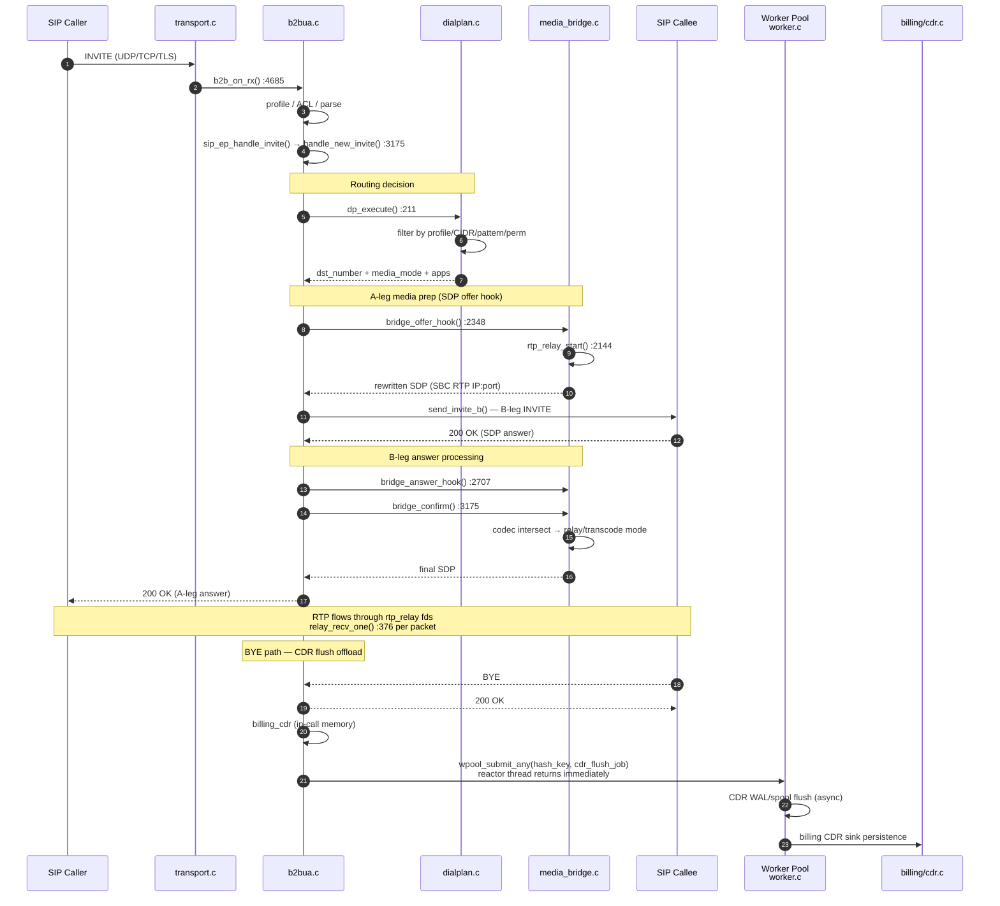
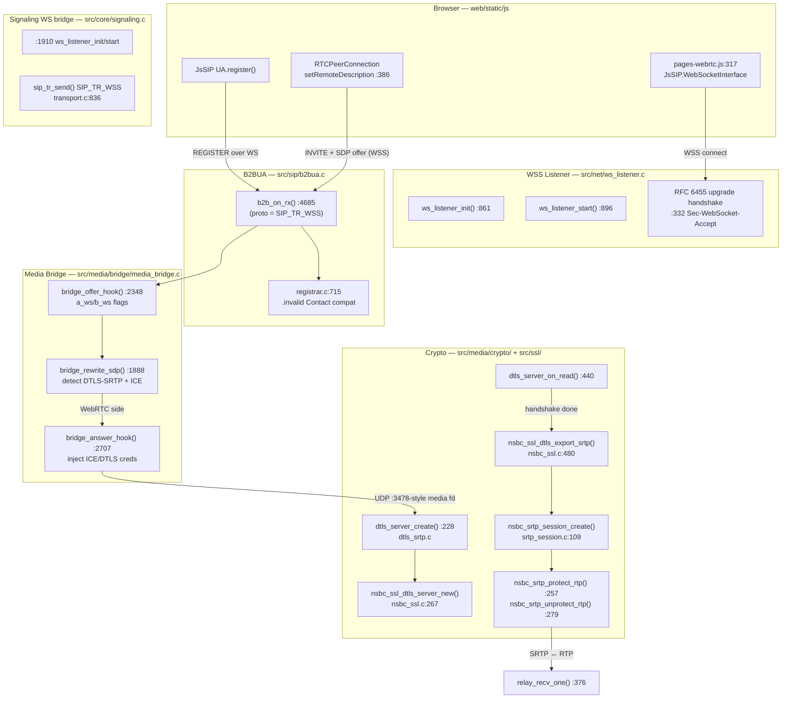
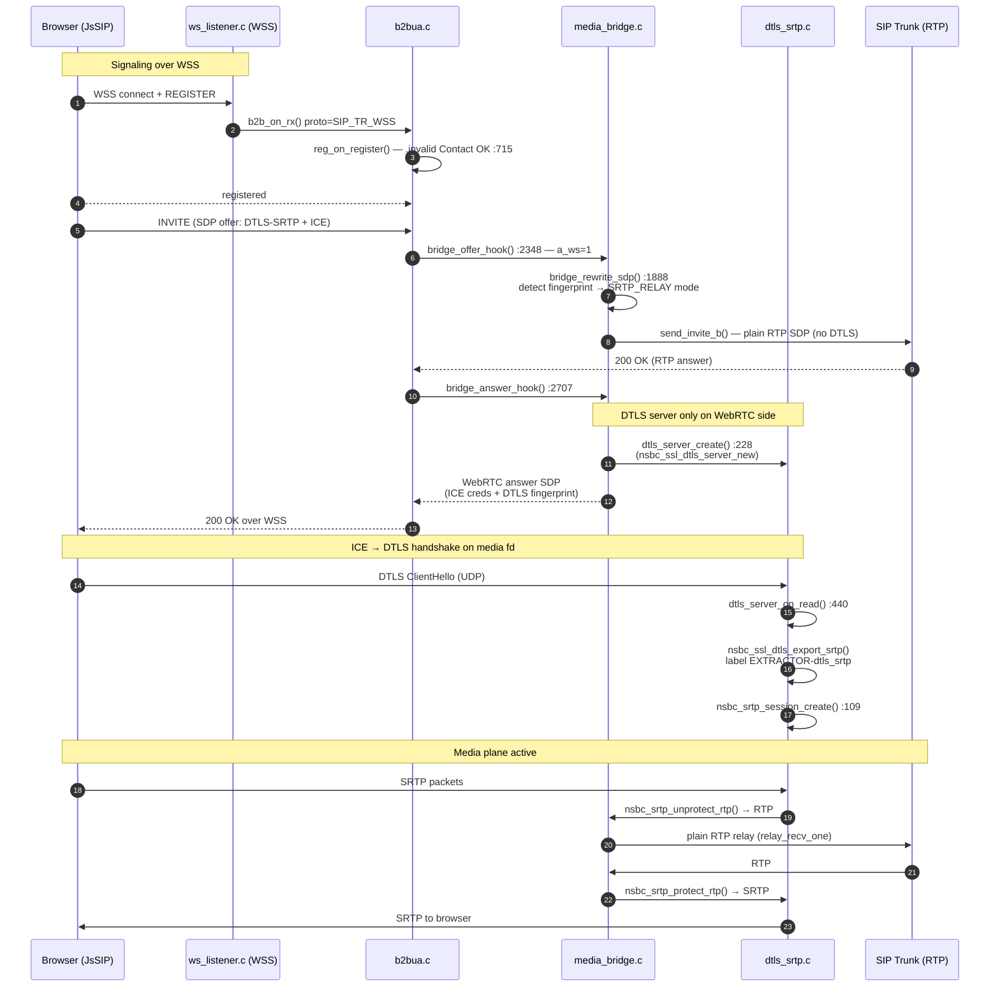
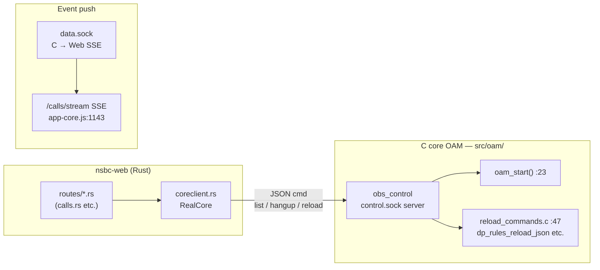

# NSBC Call-Flow Reference — SIP & WebRTC

Function-level call chains for the two primary media paths, derived from the current source
tree. Every function name below is real and can be jumped to directly. Pair this document
with [architecture.md](architecture.md) (module-level view).

- **Part 1 — SIP trunk call** (RTP): WSS/WSS-free signaling, dialplan routing, RTP relay.
- **Part 2 — WebRTC call** (DTLS-SRTP): WSS signaling, ICE, DTLS handshake, SRTP bridging.

---

## Part 1 — SIP Signaling Call Chain (RTP path)

### 1.1 Overview

```mermaid
flowchart TD
    subgraph NET["Network I/O"]
        EPOLL[Reactor Manager<br/>reactor_manager.c (N epoll reactors)]
    end

    subgraph TRANS["SIP Transport — src/sip/transport.c"]
        TR["sip_tr_send()<br/>UDP / TCP / TLS / WS / WSS"]
    end

    subgraph B2B["B2BUA Core — src/sip/b2bua.c"]
        RX["b2b_on_rx() :4685"]
        HNI["handle_new_invite() :3175"]
        SIB["send_invite_b()"]
    end

    subgraph SIG["Signaling Layer — src/core/signaling.c"]
        EPREG["endpoint_registry.c :177<br/>accept / dispatch"]
        SEHI["sip_ep_handle_invite() :317"]
    end

    subgraph REG["Registrar — src/registrar/registrar.c"]
        ROR["reg_on_register() :470"]
    end

    subgraph DP["Dialplan — src/mod/dialplans/"]
        DPE["dp_execute() :211"]
        APPR["app_execute()<br/>app_registry.c :108"]
    end

    subgraph MB["Media Bridge — src/media/bridge/media_bridge.c"]
        BOH["bridge_offer_hook() :2348"]
        BAH["bridge_answer_hook() :2707"]
        BCF["bridge_confirm() :3175"]
        RR["rtp_relay_start() :2144"]
    end

    EPOLL -->|"SIP bytes"| RX
    RX -->|"REGISTER"| ROR
    RX -->|"INVITE"| EPREG
    EPREG --> SEHI --> HNI
    HNI --> DPE
    DPE -->|"routing decision"| HNI
    HNI --> BOH
    HNI -->|"B-leg INVITE"| SIB --> TR
    BOH --> RR
    SIB --> BAH
    BAH --> BCF
```

### 1.2 Step-by-step call chain



### 1.3 Function reference table

| Layer | Function | File:Line | Responsibility |
|---|---|---|---|
| Transport | `sip_tr_send` | src/sip/transport.c:836 | Outbound SIP over UDP/TCP/TLS/WS/WSS |
| B2BUA rx | `b2b_on_rx` | src/sip/b2bua.c:4685 | Inbound SIP entry: parse, profile/ACL routing |
| Endpoint | (dispatch loop) | src/core/endpoint_registry.c:177 | Iterate endpoints → `handle_invite` |
| Signaling | `sip_ep_handle_invite` | src/core/signaling.c:317 | Unpack invite ctx → `handle_new_invite` |
| Call setup | `handle_new_invite` | src/sip/b2bua.c:3175 | B2BUA A-leg: auth, routing, app chain |
| Dialplan | `dp_execute` | src/mod/dialplans/dialplan.c:211 | Rule match: profile/CIDR/pattern/permission |
| Apps | `app_execute` | src/mod/dialplans/app_registry.c:108 | Run app chain (bridge/playback/answer/…) |
| Registrar | `reg_on_register` | src/registrar/registrar.c:470 | REGISTER handling, location bindings |
| Media offer | `bridge_offer_hook` | src/media/bridge/media_bridge.c:2348 | A-leg SDP rewrite, relay allocation |
| Media answer | `bridge_answer_hook` | src/media/bridge/media_bridge.c:2707 | B-leg SDP rewrite, peer address latch |
| Media confirm | `bridge_confirm` | src/media/bridge/media_bridge.c:3175 | Codec decision: bypass/relay/transcode |
| Relay | `rtp_relay_start` | src/media/bridge/media_bridge.c:2144 | Allocate RTP/RTCP fd pairs per side |
| Relay loop | `relay_recv_one` | src/media/bridge/media_bridge.c:376 | Per-packet forward (SRTP decrypt if needed) |
| Outbound | `send_invite_b` | src/sip/b2bua.c:3820 (path) | Build + send B-leg INVITE |
| **Worker offload** | `wpool_submit_any` | src/core/worker.c:590 | Worker Pool 任意 worker 投递（RR + slot_ready skip）|
| **Worker offload** | `wpool_submit` | src/core/worker.c:551 | Worker Pool 固定 shard 投递（hash_key % n_active）|
| **BYE → CDR** | `billing_cdr` (in-call) → wpool_submit_any → WAL flush | src/mod/billing/cdr.c | 呼叫拆除时 reactor 线程投递，Worker 异步持久化 |

---

## Part 2 — WebRTC Call Chain (DTLS-SRTP path)

### 2.1 Overview

A WebRTC endpoint registers over **WSS** (WebSocket Secure), negotiates DTLS-SRTP via SDP,
and the SBC terminates DTLS on its own UDP fds, bridging SRTP ↔ plain RTP.



### 2.2 Sequence — WebRTC endpoint calls a SIP trunk



### 2.3 Function reference table

| Layer | Function | File:Line | Responsibility |
|---|---|---|---|
| Frontend | `WebSocketInterface` / `ua.register` | web/static/js/pages-webrtc.js:317 | WSS connect + SIP REGISTER |
| Frontend | `setRemoteDescription` handler | web/static/js/pages-webrtc.js:386 | SDP answer → RTCPeerConnection |
| WSS | `ws_listener_init` | src/net/ws_listener.c:861 | Bind WSS port + TLS ctx |
| WSS | `ws_listener_start` | src/net/ws_listener.c:896 | Accept loop (epoll) |
| WSS | (upgrade handshake) | src/net/ws_listener.c:332 | RFC 6455: verify key, send accept |
| Signaling | (WS listener start) | src/core/signaling.c:1910 | Bridge WS ↔ SIP stack |
| Transport | `sip_tr_send` (WSS branch) | src/sip/transport.c:836 | SIP frame → WebSocket send |
| Registrar | (`.invalid` compat) | src/registrar/registrar.c:715 | Accept `.invalid` Contact for WS |
| Bridge | `bridge_offer_hook` | src/media/bridge/media_bridge.c:2348 | Set `a_ws/b_ws`, choose BYPASS/RELAY |
| Bridge | `bridge_rewrite_sdp` | src/media/bridge/media_bridge.c:1888 | Detect DTLS-SRTP/ICE in SDP |
| Bridge | `bridge_answer_hook` | src/media/bridge/media_bridge.c:2707 | Create DTLS server (WebRTC side only), inject ICE creds |
| DTLS | `dtls_server_create` | src/media/crypto/dtls_srtp.c:228 | DTLS role/cert/profile per media fd |
| DTLS | `dtls_server_on_read` | src/media/crypto/dtls_srtp.c:440 | Handshake pump + record dispatch |
| DTLS | `dtls_server_take_srtp` | src/media/crypto/dtls_srtp.c | Export SRTP material after ESTABLISHED |
| SSL | `nsbc_ssl_dtls_server_new` | src/ssl/nsbc_ssl.c:267 | OpenSSL DTLS: self-signed cert, fingerprint check |
| SSL | `nsbc_ssl_dtls_export_srtp` | src/ssl/nsbc_ssl.c:480 | Keying material via `EXTRACTOR-dtls_srtp` |
| SRTP | `nsbc_srtp_session_create` | src/media/crypto/srtp_session.c:109 | libsrtp session from exported material |
| SRTP | `nsbc_srtp_protect_rtp` / `unprotect` | src/media/crypto/srtp_session.c:257/:279 | Per-packet encrypt/decrypt |
| Relay | `relay_recv_one` | src/media/bridge/media_bridge.c:376 | SRTP side → decrypt → forward RTP |

### 2.4 Media mode decision (WebRTC-aware)

```
bridge_offer_hook() + bridge_rewrite_sdp() decide per call:

  WebRTC ↔ WebRTC  →  BYPASS   (P2P, SBC rewrites SDP only)
  WebRTC ↔ RTP     →  SRTP_RELAY (SBC terminates DTLS, bridges SRTP↔RTP)
  RTP ↔ RTP        →  RELAY    (plain RTP relay, optional transcode in bridge_confirm)
```

---

## Part 3 — Web (nsbc-web) → Core control path

The web sidecar drives the above call chains through two UDS channels (no DB access from C core):



---

## Quick navigation

| Want to trace… | Start at |
|---|---|
| A SIP message arriving | `b2b_on_rx` — src/sip/b2bua.c:4685 |
| Routing decisions | `dp_execute` — src/mod/dialplans/dialplan.c:211 |
| App execution (bridge/playback) | `app_execute` — src/mod/dialplans/app_registry.c:108 |
| Media allocation | `bridge_offer_hook` — src/media/bridge/media_bridge.c:2348 |
| WebRTC detection | `bridge_rewrite_sdp` — src/media/bridge/media_bridge.c:1888 |
| DTLS handshake | `dtls_server_on_read` — src/media/crypto/dtls_srtp.c:440 |
| SRTP keys | `nsbc_ssl_dtls_export_srtp` — src/ssl/nsbc_ssl.c:480 |
| Per-packet media | `relay_recv_one` — src/media/bridge/media_bridge.c:376 |
| Web → core commands | `coreclient.rs` (web/src) → `obs_control` (src/oam/) |
