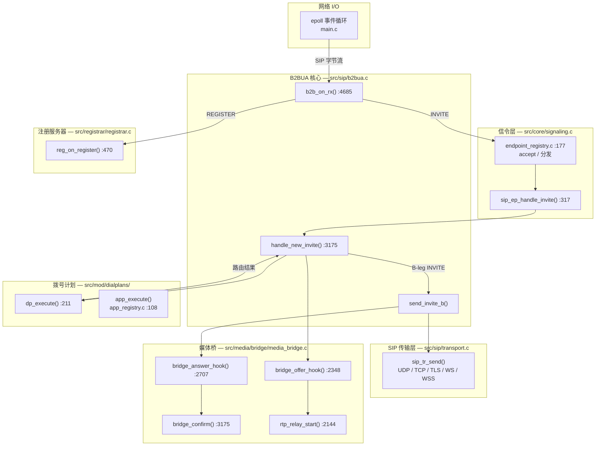
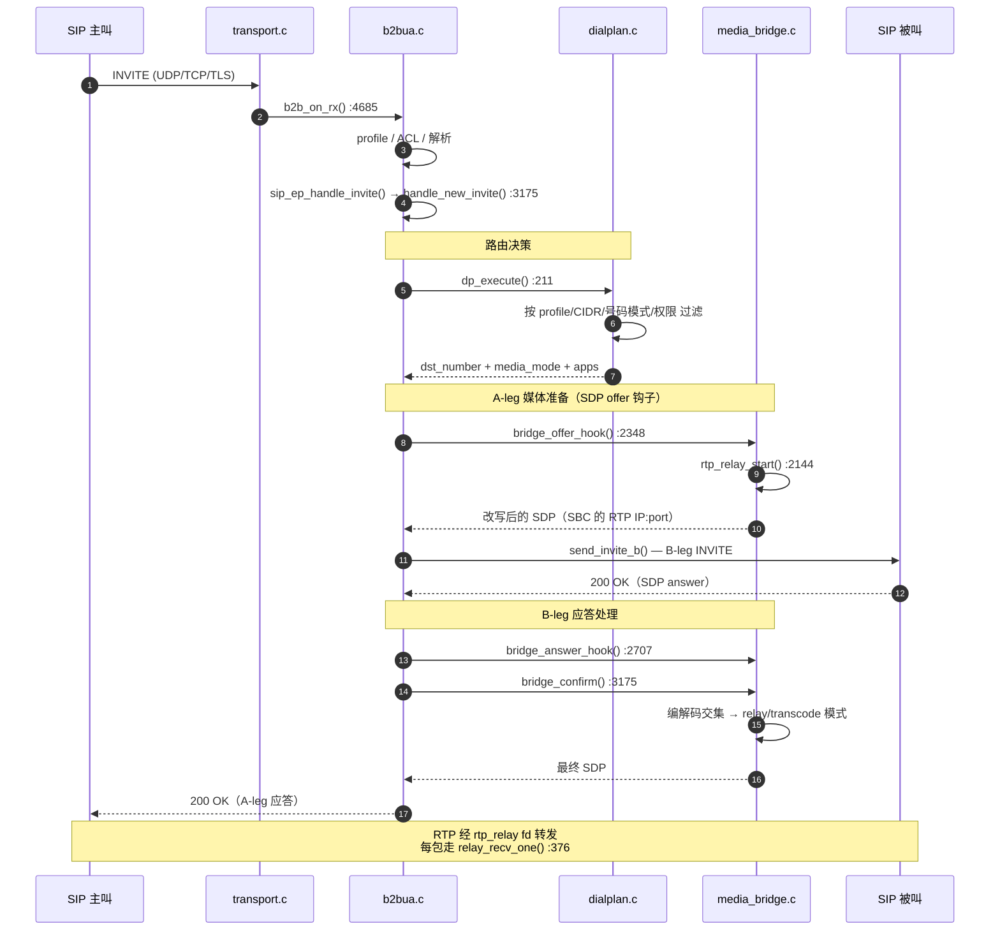
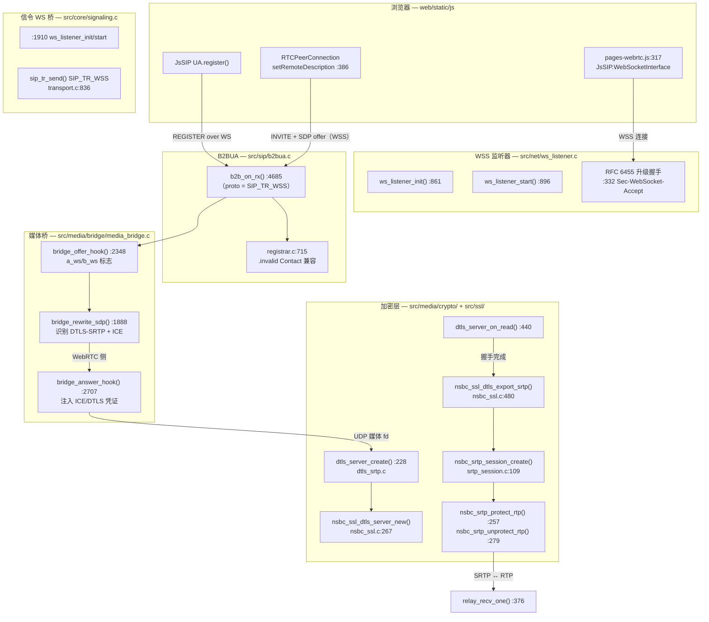
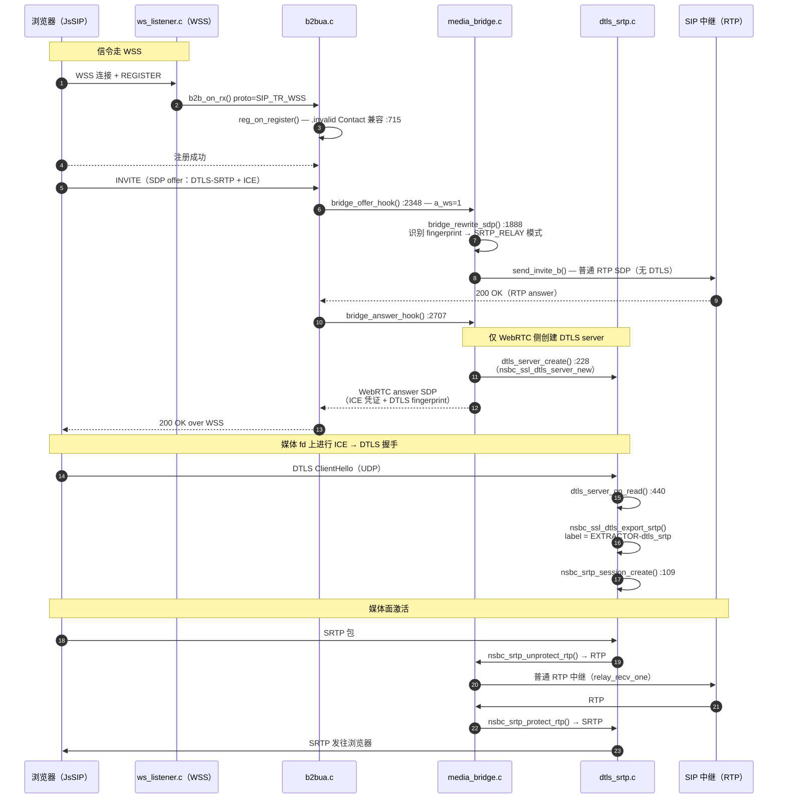
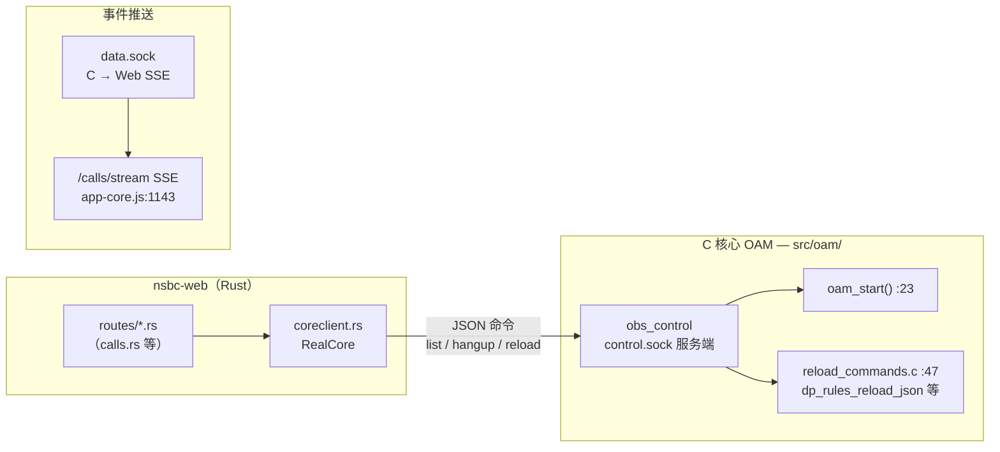

# NSBC 调用链参考 — SIP 与 WebRTC

两条主媒体路径的函数级调用链，全部取自当前源码。文中每个函数名都是真实的，可直接跳转。
模块级视图请配合 [architecture.md](architecture.md) 阅读。

- **第一部分 — SIP 中继呼叫**（RTP 路径）：信令收发、拨号计划路由、RTP 中继。
- **第二部分 — WebRTC 呼叫**（DTLS-SRTP 路径）：WSS 信令、ICE、DTLS 握手、SRTP 桥接。
- **第三部分 — Web 控制面**：nsbc-web 通过 UDS 驱动上述链路。

---

## 第一部分 — SIP 信令调用链（RTP 路径）

### 1.1 总览



### 1.2 逐步调用时序



### 1.3 函数速查表

| 层 | 函数 | 文件:行 | 职责 |
|---|---|---|---|
| 传输 | `sip_tr_send` | src/sip/transport.c:836 | 出站 SIP（UDP/TCP/TLS/WS/WSS） |
| B2BUA 入口 | `b2b_on_rx` | src/sip/b2bua.c:4685 | 入站 SIP 总入口：解析、profile/ACL 路由 |
| 端点注册 | （分发循环） | src/core/endpoint_registry.c:177 | 遍历端点 → `handle_invite` |
| 信令 | `sip_ep_handle_invite` | src/core/signaling.c:317 | 解包 invite ctx → `handle_new_invite` |
| 呼叫建立 | `handle_new_invite` | src/sip/b2bua.c:3175 | A-leg：鉴权、路由、App 链 |
| 拨号计划 | `dp_execute` | src/mod/dialplans/dialplan.c:211 | 规则匹配：profile/CIDR/模式/权限 |
| App 执行 | `app_execute` | src/mod/dialplans/app_registry.c:108 | 执行 App 链（bridge/playback/answer…） |
| 注册 | `reg_on_register` | src/registrar/registrar.c:470 | REGISTER 处理、位置绑定 |
| 媒体 offer | `bridge_offer_hook` | src/media/bridge/media_bridge.c:2348 | A-leg SDP 改写、中继分配 |
| 媒体 answer | `bridge_answer_hook` | src/media/bridge/media_bridge.c:2707 | B-leg SDP 改写、对端地址锁定 |
| 媒体确认 | `bridge_confirm` | src/media/bridge/media_bridge.c:3175 | 编解码决策：bypass/relay/transcode |
| 中继 | `rtp_relay_start` | src/media/bridge/media_bridge.c:2144 | 每侧分配 RTP/RTCP fd 对 |
| 中继循环 | `relay_recv_one` | src/media/bridge/media_bridge.c:376 | 逐包转发（需要时 SRTP 解密） |
| 出站 | `send_invite_b` | src/sip/b2bua.c:3820（路径） | 构造并发送 B-leg INVITE |

---

## 第二部分 — WebRTC 调用链（DTLS-SRTP 路径）

### 2.1 总览

WebRTC 终端通过 **WSS**（WebSocket Secure）注册，经 SDP 协商 DTLS-SRTP，
SBC 在自己的 UDP fd 上终结 DTLS，完成 SRTP ↔ 普通 RTP 的桥接。



### 2.2 时序 — WebRTC 终端呼叫 SIP 中继



### 2.3 函数速查表

| 层 | 函数 | 文件:行 | 职责 |
|---|---|---|---|
| 前端 | `WebSocketInterface` / `ua.register` | web/static/js/pages-webrtc.js:317 | WSS 连接 + SIP REGISTER |
| 前端 | `setRemoteDescription` 处理器 | web/static/js/pages-webrtc.js:386 | SDP answer → RTCPeerConnection |
| WSS | `ws_listener_init` | src/net/ws_listener.c:861 | 绑定 WSS 端口 + TLS ctx |
| WSS | `ws_listener_start` | src/net/ws_listener.c:896 | accept 循环（epoll） |
| WSS | （升级握手） | src/net/ws_listener.c:332 | RFC 6455：校验 key，回 accept |
| 信令 | （WS 监听器启动） | src/core/signaling.c:1910 | 桥接 WS ↔ SIP 协议栈 |
| 传输 | `sip_tr_send`（WSS 分支） | src/sip/transport.c:836 | SIP 帧 → WebSocket 发送 |
| 注册 | （`.invalid` 兼容） | src/registrar/registrar.c:715 | 接受 WS 场景的 `.invalid` Contact |
| 媒体桥 | `bridge_offer_hook` | src/media/bridge/media_bridge.c:2348 | 置 `a_ws/b_ws`，选 BYPASS/RELAY |
| 媒体桥 | `bridge_rewrite_sdp` | src/media/bridge/media_bridge.c:1888 | 识别 SDP 中的 DTLS-SRTP/ICE |
| 媒体桥 | `bridge_answer_hook` | src/media/bridge/media_bridge.c:2707 | 仅 WebRTC 侧建 DTLS server，注入 ICE 凭证 |
| DTLS | `dtls_server_create` | src/media/crypto/dtls_srtp.c:228 | 每媒体 fd 的 DTLS 角色/证书/Profile |
| DTLS | `dtls_server_on_read` | src/media/crypto/dtls_srtp.c:440 | 握手泵 + 记录分发 |
| DTLS | `dtls_server_take_srtp` | src/media/crypto/dtls_srtp.c | ESTABLISHED 后导出 SRTP 材料 |
| SSL | `nsbc_ssl_dtls_server_new` | src/ssl/nsbc_ssl.c:267 | OpenSSL DTLS：自签证书、指纹校验 |
| SSL | `nsbc_ssl_dtls_export_srtp` | src/ssl/nsbc_ssl.c:480 | 用 `EXTRACTOR-dtls_srtp` 导出密钥材料 |
| SRTP | `nsbc_srtp_session_create` | src/media/crypto/srtp_session.c:109 | 由导出材料建 libsrtp 会话 |
| SRTP | `nsbc_srtp_protect_rtp` / `unprotect` | src/media/crypto/srtp_session.c:257/:279 | 逐包加解密 |
| 中继 | `relay_recv_one` | src/media/bridge/media_bridge.c:376 | SRTP 侧解密 → 转发 RTP |

### 2.4 媒体模式决策（WebRTC 感知）

```
bridge_offer_hook() + bridge_rewrite_sdp() 按呼叫决策：

  WebRTC ↔ WebRTC  →  BYPASS    （P2P，SBC 只改写 SDP）
  WebRTC ↔ RTP     →  SRTP_RELAY（SBC 终结 DTLS，桥接 SRTP↔RTP）
  RTP ↔ RTP        →  RELAY     （普通 RTP 中继，bridge_confirm 可选转码）
```

---

## 第三部分 — Web（nsbc-web）→ 核心控制面

Web 边车通过两条 UDS 通道驱动上述链路（C 核心不访问数据库）：



---

## 快速导航

| 想追踪… | 起点 |
|---|---|
| SIP 消息到达 | `b2b_on_rx` — src/sip/b2bua.c:4685 |
| 路由决策 | `dp_execute` — src/mod/dialplans/dialplan.c:211 |
| App 执行（bridge/playback） | `app_execute` — src/mod/dialplans/app_registry.c:108 |
| 媒体分配 | `bridge_offer_hook` — src/media/bridge/media_bridge.c:2348 |
| WebRTC 检测 | `bridge_rewrite_sdp` — src/media/bridge/media_bridge.c:1888 |
| DTLS 握手 | `dtls_server_on_read` — src/media/crypto/dtls_srtp.c:440 |
| SRTP 密钥 | `nsbc_ssl_dtls_export_srtp` — src/ssl/nsbc_ssl.c:480 |
| 逐包媒体处理 | `relay_recv_one` — src/media/bridge/media_bridge.c:376 |
| Web → 核心命令 | `coreclient.rs`（web/src）→ `obs_control`（src/oam/） |
