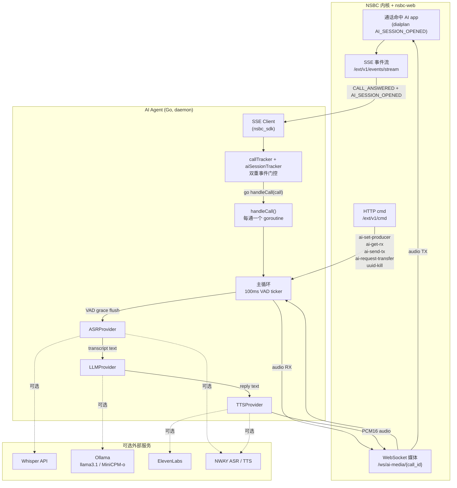

# NSBC AI 客服接入 — 外部 Agent 架构

NSBC 不内置 LLM/ASR/TTS，而是通过 **外部 Agent** 模式接入 AI 能力。Agent 作为独立进程常驻，通过 SSE 订阅 NSBC 的实时事件，对每通命中 AI app 的通话启动一个 goroutine 跑 `ASR → LLM → TTS` 主循环，通过 `nsbc-web` 的 HTTP / WebSocket 接口收发媒体流。

核心价值：

- **零强耦合** — Agent 进程独立，重启不影响 NSBC 通话；NSBC 内核零 AI 依赖
- **纯 stdlib Go** — 无第三方依赖，单二进制部署
- **双 Transport** — WebSocket 全双工媒体流（优先） + HTTP 轮询降级（fallback）
- **可插拔 Provider** — ASR / LLM / TTS 三组件各自抽象，mock 即可跑通，生产接 Whisper / Ollama / NWAY / ElevenLabs

---

## 一、整体架构



**关键设计**：

- **双重事件门控**：收到 `AI_SESSION_OPENED`（C 侧 dialplan 命中 ai app）+ `CALL_ANSWERED`（媒体建立）才启动 goroutine，防止普通通话空转
- **goroutine 生命周期**：每通一个 `handleCall()` goroutine，`CALL_END` 事件到达后主动退出 + cleanup
- **主循环永不阻塞**：VAD ticker 只做状态检测 + 设 flag；ASR/LLM/TTS-Synthesize 在主循环尾部异步触发；TTS 播放在独立 goroutine

---

## 二、Provider 抽象

三个接口 + 三种实现，全部纯 stdlib Go：

```go
type ASRProvider interface {
    Transcribe(pcmu []byte) string    // PCMU 8kHz → 文字
}

type LLMProvider interface {
    Chat(transcript string) LLMReply  // 文字 → 结构化回复
}

type TTSProvider interface {
    Synthesize(text string) []byte    // 文字 → PCM16_LE 8kHz
}
```

### ASR

| Provider | 协议 | 输入 | 输出 |
|---|---|---|---|
| `MockASR` | 能量阈值检测 | PCMU | 触发词（如 "我想转人工"） |
| `WhisperASR` | REST `audio/transcriptions` | PCMU → WAV → multipart | transcript 文本 |
| `NWAYASR` | TCP 4B_LE 协议 | PCMU → 8k→16k → PCM16 | UTF-8 transcript |

### LLM

| Provider | 协议 | 关键点 |
|---|---|---|
| `MockLLM` | 关键词匹配 | transfer/hangup/say 三档响应 |
| `OllamaLLM` | REST `/api/chat` | `format: "json"` 强制结构化输出；失败自动 keyword fallback |

LLM 回复是结构化的：

```go
type LLMReply struct {
    Action string `json:"action"` // "say" | "transfer" | "hangup" | "silence"
    Text   string `json:"text,omitempty"`
    Dest   string `json:"dest,omitempty"`     // transfer 目标分机
    Reason string `json:"reason,omitempty"`
}
```

System prompt 让 Ollama 严格输出 JSON，失败时 keyword fallback 兜底。

### TTS

| Provider | 协议 | 输出 |
|---|---|---|
| `MockTTS` | 生成静音帧 | 空 PCMU |
| `ElevenLabsTTS` | REST `text-to-speech` | PCM16 → PCMU |
| `NWAYTTS` | TCP v2（HEAD/DATA/END 包） | PCM16_LE 8kHz / 16kHz（downsample 到 8k） |

---

## 三、Transport：WebSocket + HTTP 双通道

### WebSocket 优先

纯 stdlib 实现 RFC 6455 子集（256EAFA5 握手）：

```
GET /ws/ai-media/{call_id}?token=<ext_key>
Upgrade: websocket
Connection: Upgrade
Sec-WebSocket-Key: <16B base64>
Sec-WebSocket-Version: 13
→ 101 Switching Protocols
→ Sec-WebSocket-Accept = base64(sha1(key + 256EAFA5-E914-47DA-95CA-C5AB0DC85B11))
```

- 双向 Binary 帧收发 PCM16_LE 音频
- 30s 心跳 Ping/Pong + 120s zombie 检测
- `producer=1`（接管音频）在连接建立后自动触发

### HTTP 降级

WebSocket 连不上时自动降级 HTTP 轮询：

| Command | 方向 | 说明 |
|---|---|---|
| `ai-set-producer {call_id} 1` | → C | 标记 AI 接管媒体 |
| `ai-get-rx {call_id} {bytes}` | ← 拉 | base64 编码的 PCMU 音频帧 |
| `ai-send-tx {call_id} {fmt} {b64}` | → 推 | PCM16_LE（fmt=1）分片推，每片 ≤ 2640B |
| `ai-vad-state {call_id}` | → 查询 | A_leg / B_leg VAD 状态 + RMS |
| `ai-request-transfer {call_id} {dest}` | → | 转接到人工分机 |
| `uuid-kill {call_id}` | → | 立即挂机 |

HTTP 模式 barge-in 每隔 5 帧查一次 VAD RMS，发现 SPEECH → 停 TTS 返回。

### 纯 Go WebSocket 实现要点

- mask/unmask 客户端帧（服务端不 mask）
- 64KB 帧上限（防 DOS）
- `poll(0)` + 50ms deadline 读循环（非阻塞）
- Pending-ping 追踪 + pong 超时检测

---

## 四、主循环

```text
┌─ 预合成欢迎语（daemon 启动时一次，零延迟直发）─┐
│                                                │
│  vadTicker (100ms)                             │
│    ├── aiVadState() → A/B leg SPEECH/SILENCE   │
│    ├── barge-in: SPEECH + ttsPlaying → 标记停  │
│    └── grace period: SILENCE 400ms → needFlush │
│                                                │
│  default 路径（永不阻塞 VAD ticker）            │
│    ├── needFlush → flushSentence()             │
│    │   ├── WAV 落盘                             │
│    │   ├── ASR.Transcribe(sentenceBuf)          │
│    │   ├── LLM.Chat(transcript)                 │
│    │   └── TTS.Synthesize(reply.Text)          │
│    │       └── go sendAudioPaced() 异步播放     │
│    ├── WebSocket: wsRxCh ← 音频帧              │
│    │   HTTP:       aiGetRx() 拉音频帧           │
│    └── sentenceBuf += rx (sentenceActive 打开) │
│                                                │
│  select:                                       │
│    case CALL_END event → return（callTracker 通知）│
│    case ttsPlayingCh → 更新 ttsPlaying flag     │
│    case vadTicker.C → 以上 ticker 逻辑          │
│    default → 以上 default 路径                  │
└────────────────────────────────────────────────┘
```

**关键设计**：

- **grace period 切句**：用户说完 400ms 后才 flush ASR，避免句末截断
- **主循环永不阻塞**：上一版 flushSentence 在 ticker select 里同步阻塞 ~5s，导致 ring buffer 塞满陈旧数据；新版把 flush 放到主循环尾部异步触发
- **sentenceBuf 安全上限**：5000ms PCMU @ 8kHz = 40000B，超长强制 flush
- **录音落盘**：每通一个 `.pcmu` 全程录音 + 每句一个 `sentence_XXX.wav`

---

## 五、G.711 μ-law 编解码

NSBC B2BUA 用 PCMU 8kHz codec，ASR/TTS 用 PCM16，中间需要编解码。纯 Go 查表法实现（ITU-T G.711）：

```go
// PcmuToPcm16 — 256 项查表，每个样例 O(1)
var muLawDecode [256]int16 = {-32124, -31100, -30076, ..., 32124}

func PcmuToPcm16(pcmu []byte) []int16 {
    out := make([]int16, len(pcmu))
    for i, b := range pcmu {
        out[i] = muLawDecode[b]     // 查表，O(1)
    }
    return out
}
```

- **重采样**：8kHz PCM16 ↔ 16kHz PCM16（整数倍，线性插值，ASR 场景质量足够）
- **NWAYTTS 直接返回 PCM16_LE**：C 侧 `ai_send_tx_audio(format=1)` 用自己的 G.711 encoder 一次编码到对端 codec（PCMA/PCMU/G729），避免 Go 侧有损 8bit + C 侧二次转码

---

## 六、SDK：nsbc_sdk

`event_client/nsbc_sdk/sdk.go` 是独立的 Go client library：

```go
// SSE 订阅（远程部署）
client := nsbc_sdk.NewSseClient(
    "https://nsbc-web.example.com/ext/v1/events/stream",
    30,  // HTTP timeout 30s
    map[string]string{"Authorization": "Bearer <ext_key>"},
)
client.Connect()
defer client.Close()

eventCh := make(chan nsbc_sdk.SseEvent, 64)
go client.IterEvents(eventCh)

for ev := range eventCh {
    frame := nsbc_sdk.SseEventToFrame(ev)
    fmt.Println(frame.Domain, frame.Fields)
}
```

也支持 UDS（本地部署）和 Originate（主动呼叫），Originate 走 UDS 优先 + HTTP fallback 双通道。

---

## 七、部署

### 依赖

| 组件 | 可选值 | 说明 |
|---|---|---|
| ASR | `mock` / `whisper` / `nway` | mock 零依赖，nway 需 NASR TCP 服务 |
| LLM | `mock` / `ollama` / `deepseek` | ollama 本地 `llama3.1:8b` 足够跑通，MiniCPM-o 4.5 一体化语音 Agent 也已接入 |
| TTS | `mock` / `elevenlabs` / `nway` | |

### daemon 模式（常驻）

```bash
go run main.go \
    --api-base https://nsbc-web.local:443 \
    --api-token <ext_key> \
    --transport auto \
    --asr nway --nway-asr-addr 127.0.0.1:8089 \
    --llm ollama --llm-endpoint http://localhost:11434/api/chat --llm-model llama3.1:8b \
    --tts nway --nway-tts-addr 127.0.0.1:8090 \
    --vad-barge-in --barge-in-rms 800 \
    --record-dir /var/log/ai_agent/records
```

### 单通模式（手动指定 call-id）

```bash
go run main.go \
    --api-base https://nsbc-web.local:443 \
    --api-token <ext_key> \
    --call-id 7gja30rf-... \
    --asr nway --tts nway
```

### MiniCPM-o 4.5 一体化方案

`ai_agent_cpm/` 目录下是跳过 NWAY ASR + MockLLM + NWAYTTS 三步合成的版本，直接把音频喂给 Ollama 上的 MiniCPM-o 4.5 模型（Whisper-medium ASR → Qwen3-8B LLM → CosyVoice2 TTS 一体化）：

```bash
go run ai_agent_cpm/main.go \
    --api-base https://127.0.0.1:8080 --api-token <ext_key> \
    --ollama-endpoint http://127.0.0.1:11434 \
    --ollama-model openbmb/minicpm-o4.5
```

---

## 八、事件流参考

Agent 监听的 SSE event + C 侧 obs_sub push frame domain 对齐：

| Domain | 方向 | 说明 |
|---|---|---|
| `AI_SESSION_OPENED` | C→Go | dialplan 命中 ai app → 创建 ai_session → 早于 CALL_ANSWERED |
| `AI_SESSION_CLOSED` | C→Go | ai_session 清理 |
| `CALL_INCOMING` | C→Go | INVITE 到达 |
| `CALL_ANSWERED` | C→Go | 媒体建立，**双重门控命中**才启动 handleCall goroutine |
| `CALL_END` | C→Go | BYE，goroutine 退出 + cleanup（producer=0 / WS close） |
| `CDR` | C→Go | 全程 JSON CDR，Agent 不接管（nsbc-web 自己存） |

**双重门控**的意义：普通通话（dialplan 没命中 ai app）也会推 CALL_ANSWERED，但不会有 AI_SESSION_OPENED。Agent 收到 CALL_ANSWERED 时先查 aiSessionTracker → 没有 OPENED 记录就跳过，避免 goroutine 空转浪费资源。

---

## 九、关键设计原则总结

| 原则 | 实现 |
|---|---|
| **零强耦合** | Agent 独立进程，nsbc-web 只暴露 HTTP + WebSocket 接口 |
| **纯 stdlib Go** | 零第三方依赖，UDS/SSE/WS/ASR/TTS 全自实现 |
| **主循环永不阻塞** | VAD ticker 100ms 只设 flag，flush 放到尾部异步触发 |
| **Grace period 切句** | 400ms 静音才 flush ASR，避免句末截断 |
| **双重事件门控** | AI_SESSION_OPENED + CALL_ANSWERED 才接管，普通通话跳过 |
| **Stream 亲和保护** | 一个 call → 一个 goroutine，G.711 纯 Go 查表 O(1) |
| **双通道降级** | WebSocket 优先 → HTTP 自动 fallback |
| **Fail-open LLM** | Ollama 请求失败 → keyword fallback，永不阻塞 |
| **录音 + 逐句 WAV** | 全程 PCM16 + 每句 sentence_XXX.wav 便于分析 |
| **Barge-in** | VAD ticker 检测 SPEECH → 停 TTS goroutine |

---

**相关源码目录**：

- `examples/event_client/go/ai_agent/` — 主 Agent（Provider 抽象 + WebSocket 实现 + handleCall 主循环）
- `examples/event_client/go/ai_agent_cpm/` — MiniCPM-o 4.5 一体化语音 Agent
- `examples/event_client/go/nsbc_sdk/sdk.go` — UDS + SSE + Originate SDK（784 行，纯 stdlib）
